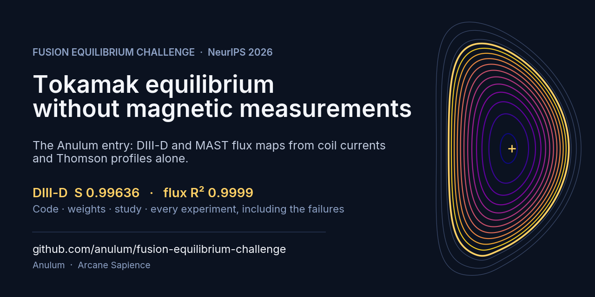

<!-- SPDX-License-Identifier: AGPL-3.0-or-later -->
# Fusion Equilibrium Challenge: the Anulum entry

[](https://github.com/anulum/fusion-equilibrium-challenge/actions/workflows/reproduce.yml)
[](https://anulum.github.io/fusion-equilibrium-challenge/)
[](https://huggingface.co/anulum/fusion-equilibrium-challenge)
[](LICENSE)
[](mailto:protoscience@anulum.li)
[](https://doi.org/10.5281/zenodo.23480092)
[](https://archive.softwareheritage.org/browse/origin/?origin_url=https://github.com/anulum/fusion-equilibrium-challenge)
[](https://github.com/sponsors/anulum)
[](https://buymeacoffee.com/anulum)



This repository is the reproduction package and the permanent record of one entry to the
[Fusion Equilibrium Challenge](https://fusion-equilibrium-challenge.sophelio.io/) (NeurIPS 2026 competition,
[Codabench competition 17739](https://www.codabench.org/competitions/17739/)), organised by
[Sophelio](https://github.com/Sophelio). The task: reconstruct the poloidal flux map of a tokamak plasma, and the two
scalars q95 and βN, from coil currents and Thomson-scattering profiles alone, without any magnetic measurement.

The entry is submitted by Anulum (Miroslav Šotek). It was developed with Arcane Sapience, the entrant's
research system built on large language models; see [How the work was done](#how-the-work-was-done).

## Result

Development phase, public test folds, submission 986068 (14 October 2026):

| Quantity | DIII-D (Challenge 1) | MAST (Challenge 2, zero-shot) |
|---|---|---|
| Composite score S | 0.996359 | 0.714450 |
| Flux map R² | 0.999883 | 0.979450 |
| q95 and βN R² | 0.998005 | 0.330685 |
| Boundary distance D_LCFS | 0.008180 | 0.191791 |
| Consistency of derived scalars | 0.987704 | 0.226646 |

On that day the entry stood tenth of 129 on DIII-D, and eleventh when the Development phase closed; the leading
score was 0.9970.

 The Final phase is scored on
blind folds; its result is added here when it is published.

Final submission **1003274** finished on 19 October 2026; its scores remain hidden until the Final closes.
It uses source tag `final-submission-2026-10-19` (`19d2d341…`) and weights revision `398d05cc…`.
The Development scores above are not Final results.

## What the model is

- **DIII-D.** 69 multilayer perceptrons answer the coordinates of the flux map in a principal-direction basis,
  together with auxiliary heads for the axis, shape, internal inductance, X-points and boundary. Four
  gradient-boosted tree heads, eight networks for q95 and βN, and eight networks for the X-point positions are
  blended in with fixed weights. A finishing step edits each map so that the scorer reads the predicted axis,
  boundary, shape and X-points.
- **MAST.** No model is trained on MAST. Each frame is reconstructed from the vacuum flux of the coil set and a
  plasma current fitted to the measured plasma current and to equal flux where the Thomson profile reads equal
  electron temperature.

[docs/METHODS_REPORT.md](docs/METHODS_REPORT.md) gives the method in two pages, including what was tried and
did not help.

## Reproduce the predictions

A first look in five minutes: [notebooks/quickstart.ipynb](notebooks/quickstart.ipynb) runs the entry on one public
DIII-D shot and draws the predicted flux surfaces
([open in Colab](https://colab.research.google.com/github/anulum/fusion-equilibrium-challenge/blob/main/notebooks/quickstart.ipynb)).

Python 3.12 on Linux; CPU only.

```bash
python3.12 -m venv .venv
.venv/bin/python -m pip install -r requirements-inference-cpu.txt
.venv/bin/python fetch_weights.py                  # downloads models/ and verifies every file
export OPENBLAS_NUM_THREADS=1 OMP_NUM_THREADS=1 JAX_PLATFORMS=cpu JAX_ENABLE_X64=1
.venv/bin/python -B infer.py --machine d3d  --data-root /path/to/data --split diii_d_public_test --workers 8 --out d3d.npz
.venv/bin/python -B infer.py --machine mast --data-root /path/to/data --split mast_public_test  --workers 8 --out mast.npz
```

`--split` is the name of any directory of shot files under `--data-root`; nothing is tied to the public folds.
Each run writes the archive in the challenge format and a receipt with coverage, source and weight hashes, wall
time and the archive's SHA-256.

Whole-fold and worker-count comparisons below used the two-Xeon build host. The separate hosted-CI row
reports the cross-CPU check. What has been checked:

| Check | Outcome |
|---|---|
| Whole public DIII-D fold, 874 shots, 193 359 frames | every map and scalar bit-identical to the submitted archive |
| Whole public MAST fold, 1 206 shots, 69 075 frames | every map and scalar bit-identical to the submitted archive |
| Fresh environment from `requirements-inference-cpu.txt`, new directories | bit-identical on the shots run |
| 22 worker processes against one | bit-identical |
| GitHub-hosted runner (another CPU), first public DIII-D shot | observed q95 and βN bit-identical; maximum flux difference 7.5 × 10⁻⁹; CI checks numerical tolerances |
| Google Colab, the quickstart notebook, 19 October 2026 | runs end to end |

Measured on a host with two Intel Xeon E5-2640 (24 threads) and 8 workers: 6 h 14 min for the DIII-D fold and
1 h 52 min for the MAST fold. With 22 workers the DIII-D fold took 3 h 15 min, again bit-identical; 22 workers need
about 42 GiB of memory.

For MAST, a shot in which no frame can be solved takes the mean current pattern of the solved frames of the
supplied fold, and missing scalars take the fold's median. Both come from inputs only; the answer for such a shot
therefore depends on the fold it is supplied with.

## Rebuild the model from the released data

```bash
.venv/bin/python -m pip install -r requirements-training-cuda.txt      # or requirements-training-cpu.txt
.venv/bin/python train.py --raw-dir /path/to/data/diii_d_train --out /work/full --platform cuda
.venv/bin/python train.py --raw-dir /path/to/data/diii_d_train --out /work/smoke --limit 4     # whole chain in minutes
```

`train.py` goes from the raw shot files to a complete model directory with its own manifest and a runnable copy
of `infer.py`. It fits DIII-D from scratch and retains the frozen MAST solver source. [TRAINING.md](TRAINING.md) describes the recipe and what the limited
mode reduces; [COMPUTE.md](COMPUTE.md) declares the compute. One network of each of the four families was
fitted with the full recipe on a single NVIDIA GTX 1060 (6 GiB) in 4.7 to 5.4 minutes.
The complete production retrain and the accuracy of its resulting ensemble have not been qualified; the
completed checks cover the reduced integration chain and one full-recipe fit per family.

## The challenge's own resources

| Resource | Link |
|---|---|
| Challenge site, rules and announcements | [fusion-equilibrium-challenge.sophelio.io](https://fusion-equilibrium-challenge.sophelio.io/) |
| Organisers on GitHub | [github.com/Sophelio](https://github.com/Sophelio) |
| Starter kit (data fixes, validator, local scorer) | [Sophelio/fusion-equilibrium-challenge-starter](https://github.com/Sophelio/fusion-equilibrium-challenge-starter) |
| Training and public-test data (v1.1.0) | [Sophelio/fusion-equilibrium-challenge](https://huggingface.co/datasets/Sophelio/fusion-equilibrium-challenge) |
| Final-phase test inputs | [ganatma/fusion-equilibrium-challenge-final](https://huggingface.co/datasets/ganatma/fusion-equilibrium-challenge-final) |
| Platform and leaderboard | [Codabench 17739](https://www.codabench.org/competitions/17739/) |

## Where things are

| Path | Content |
|---|---|
| `infer.py`, `train.py`, `tree_replica.py` | entrypoints and the tree arithmetic they share |
| `deployment.json`, `training_recipe.json` | the deployed model and the recipe that fits it, with SHA-256 of every source and weight file |
| `source/`, `training_adapter/` | model, feature and finishing code for both machines |
| `models/` | trained weights; fetched by `fetch_weights.py`, listed in `WEIGHTS.sha256` |
| `requirements-*.txt` | pinned environments |
| `DATA_PROVENANCE.md` | which data touched which part of the entry, per machine |
| `docs/` | methods report, study, experiment ledger, [what did not work](docs/NEGATIVE_RESULTS.md), cost of the entry |
| `experiments/` | frozen protocols, scripts and result files of the experiments |

The weights are not in this Git repository. `WEIGHTS.json` names the public repository and pinned revision they
are fetched from.

## How the work was done

The entry was developed by Arcane Sapience: a control-bound system of agents built on large language models
that write code, run experiments, analyse results and review each other's work under the entrant's governance.
The entrant sets direction, decides, and takes responsibility for every submission.

Later candidate experiments use protocols with written decision rules frozen before fitting or scoring, and
paired whole-shot comparisons. Early correction screens were found to be in-sample in the 28 September audit;
they are historical diagnostics, not evidence of generalisation (Study §4.5). The later evaluation copies exclude
their evaluation shots from fitting, but repeated use of those cohorts still adds selection uncertainty. A failed
rule closes that fixed experiment; it does not establish that a wider method cannot work. Two DIII-D choices
were made on the public score instead, and the study names both (§7): the shares of the scalar networks,
which failed their rule and were put to the public test once under a rule written before the submission, and the
32-network set. The ledger in `docs/` records the published experiments, including the many that failed.


## Licence and citation

Source code: AGPL-3.0-or-later ([LICENSE](LICENSE)); a commercial licence is available from the entrant. The
SPDX identifier in each file governs. The organisers' scoring functions vendored under `source/` keep their MIT
notice; see [NOTICE.md](NOTICE.md). The full challenge datasets are not included. The four EFIT reference frames
and contours used by the reconstruction figure are small CC BY 4.0 excerpts; a single-shot prediction is also
included as the CI reference. Their provenance and attribution are described in the notice.

To cite this entry, use the DOI [10.5281/zenodo.23480092](https://doi.org/10.5281/zenodo.23480092) (all versions) or see [CITATION.cff](CITATION.cff). The code is also archived by
[Software Heritage](https://archive.softwareheritage.org/browse/origin/?origin_url=https://github.com/anulum/fusion-equilibrium-challenge)
(first snapshot 19 October 2026: `swh:1:snp:143cae236c490f64c48de43ca03761a9623e16d6`). Contact: protoscience@anulum.li.

Questions about the method or the results: [Discussions](https://github.com/anulum/fusion-equilibrium-challenge/discussions).
A reproduction problem: [open an issue](https://github.com/anulum/fusion-equilibrium-challenge/issues/new?template=reproduction.yml).
The documents are also readable as a site: [anulum.github.io/fusion-equilibrium-challenge](https://anulum.github.io/fusion-equilibrium-challenge/).
