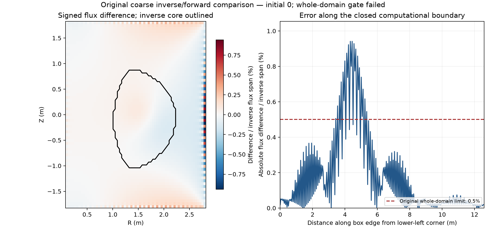

# A numerical control failed before an ambiguity witness could be admitted

This experiment searched for two static free-boundary equilibria with identical metal-coil currents and
plasma current, compatible synthetic kinetic measurements, and different internal inductance and flux maps.
It did **not** establish such a pair. A required compatibility check between the inverse reference solver and
the forward solver failed: the gauge-aligned maximum flux difference was 0.00941672 of the reference flux span,
above the predeclared 0.005 limit. The result is inconclusive about physical nonuniqueness.

A separate prescribed-current calibration localized a boundary-operator discrepancy. That calibration does
not repair the failed gate or admit a witness. Neither result establishes an information ceiling for real
DIII-D measurements, uniqueness, stability, or a competitive model improvement. No competition model or
submitted prediction changed.

## The declared physical and observation model

The geometry is the 18 shaped PF coils in FreeGS 0.8.2's `DIIID()` release model. Their shapes, quadrature and
turn counts are transferred to FreeGS4E without refitting. All 18 turn counts happen to be one; reported
currents are amperes per turn. This is an approximate release geometry, with no verified mapping to the
challenge's coil channels, central-solenoid model, passive-current dynamics or validated real operating point.
It is not a full DIII-D machine model.

The release limiter retraces part of its inner vertical segment. Both solvers use the same deterministic
Shapely `make_valid` repair, required to return one polygon without holes and preserve area within
10⁻¹² m². Its area is 2.9417763277 m². The computational box is R=[0.1,2.8] m, Z=[−1.8,1.8] m.
The plasma self-field contributes to the free boundary; there is no ideal screening wall.

One 65² FreeGS 0.8.2 inverse calculation fixes all 18 coil currents. Its parameters are central pressure
20 kPa, plasma current +1 MA and vacuum F=+3.4 T m. The control requests X-points at (1.285,−1.176) and
(1.2,1.0) m and equal flux at (1.285,−1.176) and (1.2,1.2) m, with regularization 10⁻¹².
The resulting state is **limited**; the requested X-point constraints do not make it a double-null plasma.
Currents must be finite and no larger than 5 MA per turn in magnitude before they are frozen.

The forward family uses FreeGSNKE 3.1.1 with FreeGS4E 0.15.0. Define
s=(ψ−ψ_axis)/(ψ_boundary−ψ_axis), preserving the signed flux span. In the axis-connected plasma region,

\[
p(s)=20\,000(1-s)^3,\qquad FF'(s)=A(1-s)^k,
\]

with k∈{1,1.5,2,2.5,3,4}. Only A normalizes the requested plasma current:

\[
A=\mu_0\frac{I_p-\int R p'(\psi)\,dR\,dZ}
                  {\int(1-s)^k/R\,dR\,dZ}.
\]

Pressure is not rescaled to absorb changes in the current profile. The analytic F² profile must remain
nonnegative. The synthetic kinetic model fixes n_e=3×10¹⁹(1−s) m⁻³ and
T_e=T_e0(1−s)² eV, where T_e0=20,000/(3 e·3×10¹⁹), with n_i=n_e and T_i=2T_e.
It contains no fast-ion pressure.
All these profiles vanish outside the detected core.

There are 49 radial channels on Z=0, R=0.8…2.5 m and 49 vertical channels on R=1.7, Z=−1.4…1.4 m.
All 196 density/temperature values are compared. For each channel, the shared observation is the midpoint
of the two modeled values. Each state's persistent calibration bias must be bounded by
0.02·|midpoint|+0.001·on-axis scale. These are declared synthetic allowances, not measured DIII-D uncertainties.
The minimum required relative allowance is reported with and without the absolute floor; sensitivity uses
0%, 0.5%, 1%, 2% and 5% relative allowances. No channels are selected after prediction.
These coordinates and complete firing are prescribed for the synthetic test; they do not reproduce the
released Thomson sampling.

Repeating a static state at 2,001 timestamps over one second, with the same channel biases, gives a stationary
history-compatibility test. It does not model ignition, transport, resistive current evolution, known initial
conditions or the information in a real evolving discharge.

## Numerical and witness requirements

Each exponent uses fresh 65², 129² and 257² equilibria and two independent initial plasma-flux guesses:
0.1 sin(x)sin(y) and 0.3[sin(x)sin(y)]² Wb/rad on the declared box. No solved state seeds another.
The native initialization may rescale a guess; replacement by the native default excludes independent-start
admission. The forward engine uses seed 42, the second-order GS operator, tolerance 10⁻⁹ and at most
400 iterations. The inverse uses relative/absolute tolerances 10⁻⁹/10⁻¹¹, at most 400 iterations and blend 0.5.

The fixed search orders k=2,1,1.5,2.5,3,4, then increasing grids and initialization 0/1. The budget is three
hours in total and 900 seconds per case. Exceptions, timeouts and cases not reached within the budget are
retained. Hard timeouts can lose native iteration output buffered before the solver returned; they are not
evidence of physical impossibility.

Admission requires all of the following:

- finite fields, one detected primary interior O-point and a closed ψ_N=0.999 contour away from the box;
- unchanged coil currents, relative integrated-current error ≤10⁻⁷ and real F throughout the profile;
- independently refreshed accepted-map current, discrete plasma GS residual/source RMS ≤10⁻⁶ on an
  eroded core, and full nonlinear residual ≤10⁻⁹ of the flux span;
- agreement of independent 257² starts to 10⁻⁷ of the reference span in maximum flux and 10⁻⁴ in l_i(2);
- absolute 129²→257² l_i(2) change ≤0.005 for both states;
- both coarse reference-profile starts compatible with the inverse map: gauge-aligned maximum flux/span
  ≤0.005, primary-axis distance ≤0.05625 m, the same limited regime and rectangular-current difference ≤1%.

The witness additionally needs **both** gauge-aligned map RMS ≥0.005 of the reference span and
|Δl_i(2)|≥0.05, exceeding ten times the larger refinement error, together with all-channel observation
compatibility. Model q95 and βN are descriptive diagnostics, not alternative admission paths.
The reported internal inductance uses ITER l_i(2) normalization, spline poloidal field and a 720-point
uniform-arclength ψ_N=0.999 contour. Its extraction is not byte-equivalent to the official scorer.
The alternative l_i(3), Ampère-loop current and symmetric contour distance in metres are separate quantities;
that distance is not the official D_LCFS.

## The failed coarse comparison

For the first 65², k=2 forward start, the individual numerical checks pass, but the solver-pair check fails:

| Quantity | Measured | Limit |
|---|---:|---:|
| Mean-gauge-aligned maximum flux difference/reference span | 0.00941672 | ≤0.005 |
| Primary-axis distance | 0.000489397 m | ≤0.05625 m |
| Rectangular-current relative difference | 0.0000101513 | ≤0.01 |
| Limited regime | Same | Same |

The second coarse start failed because no eroded plasma stencil was available. Thus the pair requirement
also fails. The failed tolerance remains unchanged even though the separate boundary calibration below
helps diagnose its numerical origin. Close agreement in the core cannot replace a whole-box criterion
after inspecting the result.

The public coarse NPZ retains the original inverse and forward maps, current and support. Gauge alignment
subtracts the whole-grid mean of δψ=ψ_forward−ψ_inverse before taking max|δψ|/|Δψ_inverse|.



Both panels use that same whole-grid gauge correction and inverse flux span. The maximum is **0.00941672**
at R = 2.8 m, Z = −0.05625 m, on the outer computational boundary. Within the original inverse
`limiter_core_mask > 0.5`, the descriptive maximum is **0.00136812** across 740 nodes. The right panel follows
the box counterclockwise from its lower-left corner, including each corner once and repeating the start
only to close the trace. These are errors in the original nonlinear comparison, distinct from the separate
prescribed-source boundary calibration below. Restricting the descriptive region does not replace the
whole-domain gate, which remains failed at its original limit of 0.005.

The [vector figure](figures/constructive_coarse/coarse_difference.svg) and
[exact plotted quantities](figures/constructive_coarse/coarse_difference.json) are also available.
Recreate all three outputs from the hash-pinned original bundle and record, without solving another equilibrium:

```bash
.venv-constructive/bin/python -m tools.constructive_plot --out /path/to/new-figure-directory
```

The destination must be new. Changed original inputs are refused. Figure pixels depend on the pinned
Matplotlib/font environment; the JSON retains the input and renderer hashes, gauge, normalization and full
edge trace. The [numerical environment](#reproduce-the-calculations) is installed as described below.

The fixed search continued after the failed control to retain descriptive results; no later state could
repair that admission failure. All 36 forward cases were attempted, finishing in 10,181 seconds:

| Forward outcome | Cases |
|---|---:|
| Returned and passed individual numerical checks | 11 |
| Returned but failed individual numerical checks | 14 |
| Diagnostic exception: no eroded plasma stencil | 4 |
| Reached the 900-second limit | 7 |
| Not attempted | 0 |

The [complete case ledger](https://github.com/anulum/fusion-equilibrium-challenge/blob/main/tools/reference/constructive_cases_v4.json)
also retains the inverse reference, all 196 synthetic observations for each returned forward state, original
report/map hashes and all 20 planned fine-grid reference/candidate start pairings. Sixteen pairings lack
a returned state. The four available comparisons against the returned k=2, start-1 state are:

| Candidate k / start | Both states pass individual checks? | Absolute Δl_i(2) | Map RMS/reference span | Minimum relative allowance, with floor |
|---|---|---:|---:|---:|
| 1.5 / 0 | Yes | 0.298701 | 0.033567 | 98.0893% |
| 1.5 / 1 | Yes | 0.298701 | 0.033567 | 98.0893% |
| 3 / 0 | No | 0.656786 | 0.074587 | 98.7575% |
| 3 / 1 | No | 0.663582 | 0.074713 | 98.7591% |

None passes the 2% observation criterion or any declared sensitivity allowance up to 5%. The k=1.5 states
therefore illustrate distinguishable synthetic inputs, despite substantial map and inductance differences.
The k=3 rows also fail individual numerical checks. The missing reference k=2, start-0 result prevents its
independent-start comparison. These descriptive comparisons neither establish a witness nor rule out
ambiguity elsewhere in this model or in real DIII-D data.

The largest ratios involve a zero synthetic signal in one state and depend on the declared profiles being
exactly zero outside the plasma. The mismatch extends beyond those values: among measurements positive in
both states, the required allowance is still about 78.3% for k=1.5 and 92.8% for k=3. This descriptive
subset check does not change the all-channel admission rule.

Recompute the failed coarse comparison directly from the original published arrays:

```bash
.venv-constructive/bin/python -m pytest -q tests/test_constructive_pairs.py::test_recorded_coarse_solver_gate
.venv-constructive/bin/python -m pytest -q tests/test_constructive_pairs.py::test_recorded_case_ledger_preserves_all_states
```

These check the bundle and result-file digests, source identities, coarse gauge-aligned map difference,
axis distance and integrated current, every planned case/pairing and all available channel comparisons.
They reproduce stored-result arithmetic, without re-solving or authenticating the original run. Fine-grid
map RMS values are retained summaries; this small bundle does not contain every original fine-grid map.

## Separate prescribed-source boundary calibration

This control prescribes a smooth compact source, rather than solving a nonlinear equilibrium:

\[
u=((R-1.7)/0.35)^2+(Z/0.55)^2,\qquad
J_\phi=\frac{5\times10^6}{\pi\,0.35\,0.55}(1-u)^4\quad(u<1),
\]

and zero elsewhere. Its continuous area integral is exactly 1 MA and it is C³ across its support boundary.
An independent axisymmetric filament Green integral uses 64×128 Gauss–Legendre nodes in squared elliptical
radius and angle. Doubling both orders at 17 edge probes changes flux by about 1.04×10⁻¹⁴ of its maximum
absolute edge value, 0.382783929 Wb/rad. The kernel computes R A_φ, so its flux convention is Wb/rad.

The table compares actual public boundary operators against that continuous-source reference. The error is
max|ψ_operator−ψ_reference|/max|ψ_reference| **on the box edge**; this denominator differs from the failed
nonlinear comparison's reference axis-to-boundary span. No fitted gauge shift is used in this calibration.

| Grid | FreeGSNKE Green boundary | FreeGS 0.8.2 Hagenow | FreeGS 0.8.2 direct Romberg |
|---|---:|---:|---:|
| 65² | 1.038×10⁻⁶ | 8.967×10⁻³ | 1.679×10⁻⁴ |
| 129² | 2.906×10⁻⁸ | 6.742×10⁻³ | 1.777×10⁻⁶ |
| 257² | 7.140×10⁻¹⁰ | 5.364×10⁻³ | 9.034×10⁻⁹ |

The solvers use mesh-sampled current, whereas the reference integrates the continuous source. The corresponding
total-current discretization errors are:

| Grid | Rectangle sum minus 1 MA, A | Romberg sum minus 1 MA, A |
|---|---:|---:|
| 65² | +0.781872 | −102.642597 |
| 129² | +0.007612 | +1.360291 |
| 257² | −0.000199 | +0.013852 |

FreeGS 0.8.2's `freeBoundaryHagenow` evaluates Green functions 0.01 m outside the edge. In its
`freegs/boundary.py`, lines 189–231, the down/up/left/right assignment order leaves corner observations
shifted in R only. Comparing its result with the continuous source at those shifted points gives errors
0.01318, 0.002817 and 0.0004234 on the three grids. Finite-grid boundary derivatives and line quadrature
also matter; this experiment does not attribute the whole error to the offset, nor rank the solvers in general.
For this prescribed source, the legacy Hagenow operator has the largest error at each of the three grids,
while the native Green and legacy direct-Romberg errors fall rapidly with refinement. This observation does
not change the original admission rule.
FreeGSNKE 3.1.1's `freeboundary` calls `Jtor(R,Z,psi)` and maps its output to an R,Z-aligned boundary array.

## Reproduce the calculations

Use Python 3.12.3 on Linux x86-64 and two isolated hash-pinned environments. The legacy inverse path depends
on the older SciPy interpolation API; installing its dependencies into the modern environment is incompatible.
Run from the repository root:

```bash
UV_LINK_MODE=hardlink uv venv --python 3.12.3 .venv-constructive
uv pip install --python .venv-constructive/bin/python --require-hashes -r requirements-constructive.txt
UV_LINK_MODE=hardlink uv venv --python 3.12.3 .venv-constructive-reference
uv pip install --python .venv-constructive-reference/bin/python --require-hashes -r requirements-constructive-reference.txt
```

The independent boundary control needs no trained weights or competition data:

```bash
.venv-constructive/bin/python -m tools.constructive_boundary --engine reference --size 65 --output boundary-reference.json
.venv-constructive-reference/bin/python -m tools.constructive_boundary --engine legacy --size 65 --output boundary-legacy.json
.venv-constructive/bin/python -m tools.constructive_boundary --engine native --size 65 --output boundary-native.json
```

Repeat with 129 and 257 to reconstruct the table. Output paths must be new. Each JSON records edge values,
both current quadratures, package versions and the executed source hash. The dedicated integration tests
exercise all nine engine/grid combinations against the independent integral and analytic normalization
controls. CI follows the maintained Python 3.12 patch and checks numerical tolerances; it does not require
bit identity with the original 3.12.3 calculations. Solver timing and the final floating-point bits can vary
across hosts.

The nonlinear CLI accepts a source-binding JSON, a fresh output directory, grid, exponent and initialization.
The public calculation manifest supplies the original five source hashes and scientific definitions. Its
`source_sha256` object is accepted as the binding, so the original source identity is checked before each run:

```bash
.venv-constructive-reference/bin/python -m tools.constructive_reference \
  --binding tools/reference/constructive_calculation.json --output synthetic-reference
.venv-constructive/bin/python -m tools.constructive_pairs \
  --binding tools/reference/constructive_calculation.json --currents synthetic-reference/currents.npy \
  --size 65 --power 2 --initial 0 --output synthetic-forward
```

The original fixed coil vector is also published in the synthetic test fixture. Recomputing the inverse on
a different host may produce slightly different currents; do not mix new coil vectors into the recorded
cross-grid comparison and call it the same run. Source/package identity checks are distinct from a guarantee
of numerical convergence. The [validation scope](https://github.com/anulum/fusion-equilibrium-challenge/blob/main/VALIDATION.md)
separates solver integrations, analytic controls, stored-result arithmetic and the submitted pipeline.
