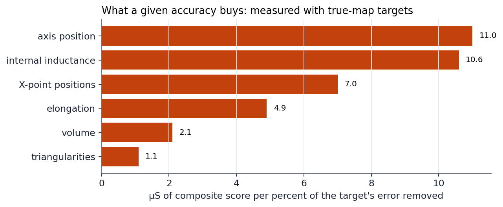
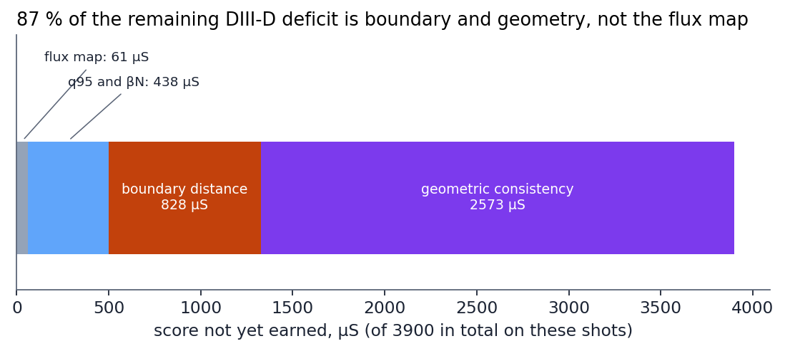
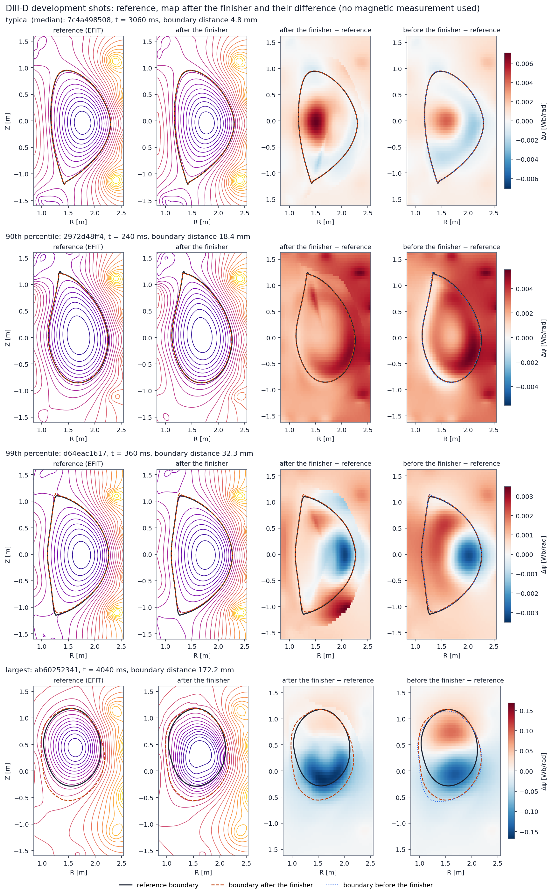
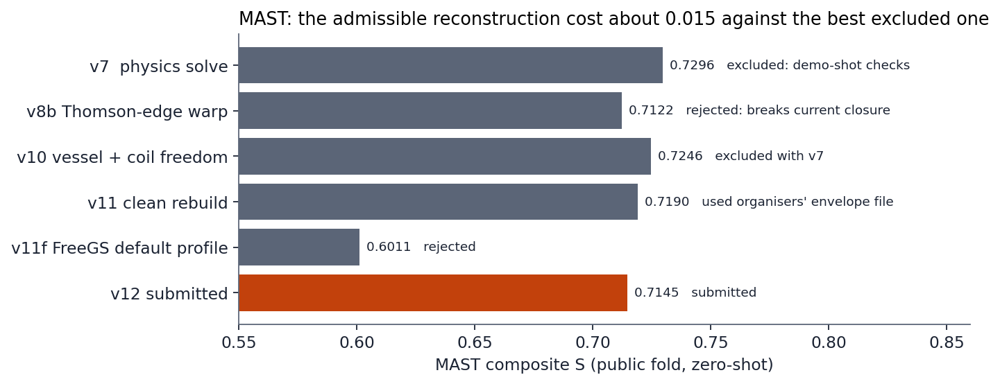
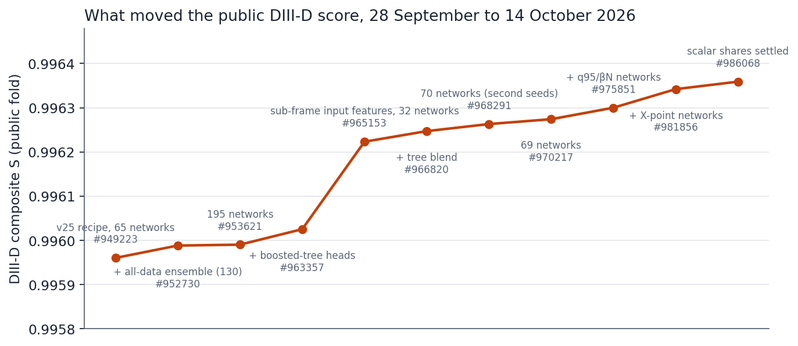
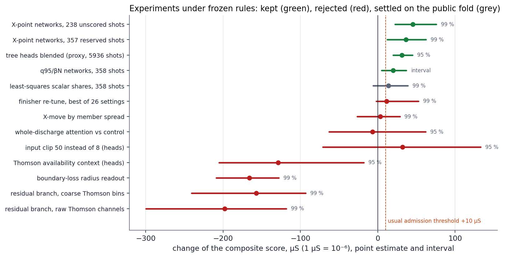

<!-- SPDX-License-Identifier: AGPL-3.0-or-later -->
# What we tried, how we measured it, and what moved the score
## Accompanying study to the Anulum entry, Fusion Equilibrium Challenge (NeurIPS 2026)

*Model of 14 October 2026, the entry displayed as Codabench submission 986068 (Development phase); text last updated
20 October 2026. The Final-phase result is added when it is published. Every number is taken from a protocol, receipt or result
file of the experiment it belongs to; [EXPERIMENT_LEDGER.md](EXPERIMENT_LEDGER.md) has one row per experiment
and names those files. The study is written in the order the work was done, and it keeps the conclusions we
later had to correct, with the correction.*

---

## 1. The problem and the score

The challenge asks for the poloidal flux map ψ(R, Z) of a tokamak plasma at each reconstruction time, on the
machine's native 65 × 65 grid, from the inputs alone: coil-circuit currents, plasma current, toroidal-field
current and Thomson-scattering profiles. No magnetic probe or flux loop is in the released data. Two machines are
scored: DIII-D, with a labelled training release, and MAST, zero-shot.

The composite score of a machine is

S = 0.55 · R²ψ + 0.15 · R²{q95, βN} + 0.10 · (1 − D_LCFS) + 0.20 · Consistency,

where D_LCFS is the symmetric Hausdorff distance between the predicted and true last closed flux surface divided
by the geometric radius, and Consistency is the mean R² of seven shape scalars that the organisers derive from a
map: the magnetic-axis position (R_axis, Z_axis), elongation κ, upper and lower triangularity, plasma volume and
internal inductance li.

For a good DIII-D entry R²ψ is already above 0.9998, so almost all of the remaining room lies in Consistency and
in the boundary. This shaped the whole programme: most of the work below is about the shape scalars and the
last closed surface, not about the flux itself.

## 2. How we worked

**Fixed split.** The labelled DIII-D shots are divided by a hash of the shot name into training (5954 shots),
calibration (372), validation (357) and holdout (358). The holdout was meant to be opened once for a final
estimate; §4.5 records how it was used.

**Frozen protocols.** Every experiment that could change the entry was written down before it ran: the question,
the data, the metric, the acceptance rule. Changes after freezing were recorded as numbered amendments, and only
before any result of the affected experiment had been seen. Negative results were kept.

**Out-of-sample evaluation.** From 28 September every lever was measured on shots the networks never saw:
out-of-fold maps from a five-fold refit (§4.1), the validation part, and — once — the holdout.

**Uncertainty.** Differences are reported with a paired whole-shot bootstrap (20 000 resamples, fixed seed).
At the level of the gains discussed here (1–3 × 10⁻⁵ in S) the resolution of a 358-shot set is about
± 4 × 10⁻⁵ and of the 874-shot public test about ± 3 × 10⁻⁵; single small gains are therefore not claimed
individually, only when a principled mechanism and consistent evidence agree.

**Agents and hardware.** The entry was developed by Arcane Sapience, the entrant's research system built on
large language models: a control-bound system of agents that write code, run experiments and review each
other's work under the entrant's governance. Two agents did most of the work and are called the first and the
second agent below; each reviewed the other's experiments, and several results in §4 exist because one of them
re-measured what the other had rejected or accepted. Compute was outdated consumer and server hardware (an
Intel i5-11600K workstation with five AMD RX 6600 XT cards and one NVIDIA GTX 1060; an HP ProLiant ML350p Gen8
with two Xeon E5-2640) and Kaggle's free tier (2 × T4 sessions and CPU sessions).

**Constraints.** The entry had a limited allowance of language-model use allocated to it, and limited compute;
the compute limit was partly intentional. Both shaped the programme: experiments were sized to consumer cards
and an old server, a full rebuild of the public DIII-D fold cost about 50 CPU-hours, and the questions asked
were chosen to be answerable at that scale. [COSTS.md](COSTS.md) gives the estimate of what the entry cost.

**Cohorts after 7 October.** Later sections use two cohorts of whole shots held out of every fit they judge:
358 development shots, split into 120 for screening and 238 for a first confirmation, and 357 shots reserved
for a final confirmation. §4.21 records when the last of them was spent; from then on no unscored cohort
existed, and every later comparison says that it was made on shots used before.

## 3. The DIII-D recipe

The recipe is described first as it stood on 28 September (v25), the starting point of §4, and then as it is
submitted.

**Representation.** Each map is written in a basis of principal directions fitted to the training maps
(128 directions); 45 coordinates are kept, the rest held at the mean map.

**Networks.** The submitted recipe v25 has 65 multilayer perceptrons: 16 fitted directly to the flux
coordinates, q95, βN, li and the axis, and 49 "readout-bank" members whose final linear readout of the
original-map geometry (shape values, X-points, 64 boundary radii about the axis) is refitted by ridge regression
(λ = 0.001). Their outputs are averaged.

**Finisher.** The mean prediction is turned into a map in stages: time smoothing of the later coordinates
(from coordinate 30, over 2 frames); moving the axis onto the predicted axis (3 rounds); a smooth deformation so
that the organisers' reading of the map returns the predicted κ, triangularities, volume and li (shares 0.5 for
κ and volume, 0.25 for the triangularities, 0.6 for li, 0.5 for the other geometric levers); a saddle move of the
X-points (window 0.15); a radial bend of the boundary towards the predicted radii before the shape edit
(contour share 0.5, one round); a second shape pass.

**Stage attribution (out of fold).** On 80 held-out training shots, raw prediction with 64 coordinates scores
S = 0.99359 and the full v25 finisher 0.99573. The residual loss after finishing sits in the scalars: li
(R² 0.963), κ (0.980) and R_axis (0.983).

**Public result.** #949223 (v25): DIII-D S 0.995960 (R²ψ 0.99988, R²{q95,βN} 0.99767, D 0.00890,
Consistency 0.98633).

**The deployed recipe (14 October).** Sections 4.15 to 4.23 changed nearly every part of this recipe; what is
submitted now is the following.

- *Inputs:* 582 features per frame, the 367 of the September table and 215 that describe the signals inside
  and around a frame (§4.16).
- *Maps:* 69 networks of the two readout-bank families that read those features (§4.17, §4.18); the model
  answers 64 coordinates and keeps the leading 45, because beyond them a predicted coordinate adds more error
  than it removes (§4.19).
- *Tree heads:* four gradient-boosted heads blended into the network heads at fixed weights: internal
  inductance 0.26, axis radius 0.14, elongation 0.09, lower X-point radius 0.16 (§4.15).
- *X-points:* eight networks that answer only the X-point positions supply half of the X-point targets
  (§4.21).
- *Submitted scalars:* eight networks that answer only q95 and βN supply 0.46 of q95 and 0.87 of βN; the 69
  supply the rest (§4.18, §4.23).
- *Finisher:* the stages and shares above, unchanged since September; two later re-examinations found them
  still at their optimum (§4.14, §4.19).

Public result of this recipe: #986068, DIII-D S 0.996359 (R²ψ 0.999883, R²{q95,βN} 0.998005, D 0.008180,
Consistency 0.987704).

## 4. DIII-D: what we tried and what it gave

### 4.1 First, honesty of the evaluation
An audit on 28 September found that all 65 v25 members were fitted on the training part and 50 also on the
calibration part. Every earlier screen of a map correction on those parts was therefore in-sample. We refitted a
16-member sub-ensemble five times, each without one fifth of the training shots (80 fits on Kaggle), and built
out-of-fold (OOF) maps for 400 training shots. Fits whose calibration flux R² stayed below 0.999 were refitted
once with a new seed, else dropped (amendment 1). The OOF maps reproduce v25's validation behaviour
(X-point saddle error 3.4 / 4.0 mm), so they are a fair test bed.

### 4.2 The boundary and the X-points
The X-point corner accounts for 52 % of the excess boundary distance, and replacing our X-points by the true ones
(an oracle) would be worth about +0.0003 S. Two correctors were built under frozen protocols:
an input-only X-point head (error 6.5 / 6.8 mm against the map's own 3.6 mm) and a map-aware corrector with
nested five-fold selection on the OOF maps (worse in 5 of 5 folds). Both were rejected: the headroom is real but
not reachable from the inputs we have.

### 4.3 Is the basis the limit?
Projecting the true maps on the 45 kept coordinates gives D 0.0051 and Consistency 0.9972 (64 coordinates:
D 0.0038). Our maps are far from that ceiling, so the basis is not what limits the score; the network's scalar
accuracy is (§3, stage attribution).

### 4.4 New input features
- *Whole-shot context* features (statistics of the entire discharge): negative out of fold.
- *Physics block* (27 input-only features: Thomson peaking and widths, a kinetic-pressure and βp proxy, pedestal
  gradients, exponential histories of the plasma current and of Te^1.5, a 1-D current-diffusion model). Tested by
  whether they explain the network's own li and κ error on the 400 OOF shots (frozen rule: +0.02 residual R²,
  P ≥ 0.95). Result: li −0.045 (P 0.30), κ +0.020 (P 0.92); both arms had negative residual R². No new
  information.
- *A pitfall worth recording.* An earlier version of the diffusion test read the plasma-current time base as
  released. On about 70 % of DIII-D shots that clock is about three seconds early (the organisers' erratum; our
  reader corrects it). The earlier "no gain" was therefore invalid; the physics-block test above uses the
  corrected clock.

### 4.5 More data
A learning curve on the out-of-fold sub-ensemble suggested +0.00024 S for +25 % data. We refitted all 65 members
on all data except the holdout (v27) and, after the entrant opened it, on all labelled data (v28). At full data the
direct networks became unstable: sudden jumps of the loss (to 753 around pass 18 in one fit) without recovery, in 6 of 16
fits of each run, and re-seeding did not cure most of them. The added data held no new extremes; the cause was
training without gradient clipping. Amendment 2 refitted the dropped members with their original seed and a
gradient limit of 0.1; all eight passed (calibration flux R² 0.99979–0.99988).

The holdout, never seen by v25 or v27, gave the honest comparison: v25 0.995752, v27 0.995732 (difference
−1.9 × 10⁻⁵, 95 % interval [−6.3, +2.6] × 10⁻⁵). More data did not measurably help.

### 4.6 Ensembles
Averaging independently trained sets is the one change that consistently helped:
- v25 + v27 (130 networks), holdout: 0.995770, +1.9 × 10⁻⁵ (interval [−0.3, +4.2] × 10⁻⁵, P 0.95), gain almost
  entirely in Consistency;
- v25 + v28 (130 networks), public #952730: DIII-D S 0.995988, +2.8 × 10⁻⁵ over #949223, again from
  Consistency (0.98654 against 0.98633).
- v25 + v27 + v28 (195 networks): public S 0.995990 against 0.995988 for 130 (#953621 against #952730) — a boundary gain of 3 × 10⁻⁵ in D_LCFS offset by Consistency. The ensemble is saturated.

### 4.7 Where the remaining error lives
On the holdout we split each scalar's error into a per-shot offset, a slow drift and a fast frame-to-frame part:
li 23 / 36 / 35 %, κ 28 / 28 / 41 %, R_axis 43 / 26 / 29 %. Smoothing the predictions in time made every scalar
worse (li R² 0.9717 → 0.9677 / 0.9637 / 0.9572 for 3 / 5 / 9 frames).

We first read this as "the fast error is jitter of the reference". A dedicated analysis of the reference itself
showed that reading to be wrong, and we record the correction. The fast part of the true scalars is small
(1–3 % of their variance), it is not white (lag-1 autocorrelation 0.18–0.36: real, short physical changes), and our
predictions follow it closely (correlation of predicted and true fast parts 0.78–0.95). Smoothing hurt because it
removed real variation that the maps had right. The remaining error is therefore mostly per-shot offset and slow
drift, which are not bounded by any reference noise we can measure; this analysis gives no ceiling, and we no
longer claim to be near one.

The per-shot offset (23–38 % of the squared error of li, κ and R_axis) is the obvious next target. A shot-level
corrector fitted out of fold on the shot's mean inputs and mean predicted scalars did not explain it (R² −0.04 to
−0.22, i.e. a correction would add error), in line with the whole-shot context result of §4.4.

### 4.8 Finisher settings, re-chosen out of fold
The finisher (the fixed post-processing between the map ensemble and the submitted scalars) was tuned on
validation data. We re-chose it out of fold: ten variants on the 400 OOF shots (every second frame), the variant
picked by nested cross-validation (chosen on four folds, scored on the fifth), a paired shot bootstrap (20000
draws), and a rule frozen beforehand — accept only +2 × 10⁻⁵ with P ≥ 0.9. The nested selection took the
contour share 0.65 variant on four folds and a li share 0.8 variant on the fifth: +0.9 × 10⁻⁵ (95 % interval
[−0.5, +2.3] × 10⁻⁵, P 0.90). Even the best variant chosen in hindsight on all 400 shots gains only
+1.5 × 10⁻⁵; the rest are neutral or worse (down to −6.4 × 10⁻⁵ for a 64-coordinate boundary variant). Below
the threshold, so not adopted: the finisher settings chosen on validation hold out of fold.

### 4.9 Weight of the scalar labels in training
Each member network learns the map and the scalars together; the scalar labels carry a loss weight of 0.05. We
refitted the sixteen-member sub-ensemble of fold 0 on Kaggle GPUs with the weight raised to 0.2 for every label
(same seeds; the control member reproduced bit for bit). The targeted heads improved (li +1.2 × 10⁻³ in R²,
κ +5 × 10⁻⁴, R_axis +5.6 × 10⁻⁴, volume +2.4 × 10⁻⁴), but both triangularities fell (−7 × 10⁻⁴ and −9.6 × 10⁻⁴),
the boundary distance worsened and the members' flux fits lost accuracy. Net: +1.25 × 10⁻⁵ (P 0.57) — rejected at
screening. A uniform weight trades the boundary for the heads.

We then weighted only the heads that had gained (li, κ, R_axis, volume; 0.2, the rest left at 0.05) and, because
fold 0 had chosen them, tested this on fold 1 with the same frozen rule. It lost clearly: −1.09 × 10⁻⁴ (95 %
interval [−2.5, +0.4] × 10⁻⁴, P 0.07). Only li gained (+1.1 × 10⁻³); κ, R_axis and volume fell this time, both
triangularities fell by about 1 × 10⁻³ although their weight was not changed, and the boundary distance and
Consistency worsened. The networks share one trunk for the map and all scalars: weighting some heads more takes
accuracy from the map and from the other heads. The label weight chosen on validation stays, and we consider this
lever closed.

### 4.10 The history of the discharge
li is a history quantity, so a model that reads the whole discharge looked worth building. Before building it we
asked a cheaper question on the 400 out-of-fold shots: do the inputs and our own readings at other times
(±1 to ±8 frames, the shot's means, running means, the position in the shot) predict the error of our maps better
than the same frame alone? Boosted trees, nested by fold, nine targets (the seven shape scalars, q95, βN). The
history made every target worse (−0.015 to −0.10 in residual R²), and even the same-frame corrector mostly added
error. These correctors could not predict the ensemble's remaining error from what they were given; we did not build
the sequence model then. It was built in the last week (§4.24).

### 4.11 A boundary-label weight that did not transfer
The second agent found that cutting the loss weight of the 64 boundary-radius labels tenfold (0.05 to
0.005) improves a small four-network recipe trained for a fixed 60 epochs. Against an identically trained
control it gained +2.1 × 10⁻⁴ (P 0.997). That recipe as a whole stayed 2.6 × 10⁻³ below our deployed
ensemble, so we tested the weighting inside our own recipe.

We refitted the five boundary-head networks of our sixteen-network out-of-fold sub-ensemble, using the same seeds,
on every fold.
- **Folds 0 and 1 (160 shots).** +2.2 × 10⁻⁵ with every score term better, but P 0.74, below the screening rule.
  Folds 2–4 were already being fitted. Before any of their results existed, we froze a stricter confirmation on
  those folds (P ≥ 0.9).
- **Folds 2–4 (240 shots).** The confirmation reversed the sign: −4.2 × 10⁻⁵ (P 0.08), and Consistency fell.
- **All 400 shots.** −1.5 × 10⁻⁵ (P 0.25). The weighting is rejected.

An effect measured against a weak control does not carry to a strong ensemble. The narrow screen miss on two
folds was noise.

### 4.12 Scalar heads from specialist networks
The finisher bends each map towards the networks' scalar heads: elongation, triangularities, volume, internal
inductance and the axis position. Raising the loss weight of every scalar fourfold (D4, §6) improved those heads.
It also degraded the shared flux maps and the boundary, so the net change was nil. We therefore tried to take only the
heads from such specialist networks and to keep the flux coordinates, X-points and boundary radii from the ordinary
ensemble. All ten scalar heads were swapped together, with no choice per scalar.
- **Folds 0 and 1 (160 shots), existing fits.** +6.0 × 10⁻⁵ (P 0.98). The screen passed. Consistency rose by
  3 × 10⁻⁴, mostly inductance and volume.
- **Confirmation.** Both folds had been seen in D4 and D4b, so the confirmation used unseen folds 2–4 with newly
  fitted specialists. It was frozen before any of their results (P ≥ 0.9).
  - Two attempts on the workstation GPUs died before the first epoch, because the host ran out of memory. The fits
    moved to the cloud GPUs, by a recorded amendment.
  - Five of the 48 first fits failed the failed-fit rule. All five were resolved by the rule's pre-committed
    retry order.
- **Folds 2–4 (240 shots).** −1.0 × 10⁻⁵ (P 0.44). Elongation and axis height fell, and volume and the
  triangularities rose.
- **All 400 shots.** +1.9 × 10⁻⁵ (P 0.77). The head swap is rejected.

Specialists for deployment had already been trained on all data, so that a confirmation would not cost a day. They
are not used. Like §4.11, this is a two-fold screen that did not survive unseen folds. The confirmation rule is what
kept both out of the submission.

Because the out-of-fold framework cannot resolve effects this small (§4.13), we also measured the head swap on the
public score, with disclosure. It was built from the specialists already trained on all data, with the deployed
195-network ensemble for the flux. It scored 0.995908 against 0.995990, so it is 8 × 10⁻⁵ worse. The scalar R² and
Consistency both fell.

The public result is worse than the out-of-fold estimate for a reason we should have foreseen. Out of fold, 16
specialist heads replaced 16 ordinary heads. In the deployment, 16 specialist heads replaced heads averaged over 195
networks. That gives up most of the ensemble averaging of exactly the outputs that feed the scalar score and the
finisher.

We had also prepared a second variant, which took the X-point and boundary heads from the specialists as well. It
was withdrawn before submission on that ground. A replacement has to be deployed like for like, or the deployment
configuration itself has to be the thing tested.

### 4.13 The last labelled rows, and how much one fold can say
Five of the sixteen sub-ensemble networks, and 15 of the 65 recipe networks, never train on the calibration part
(about 7 % of the labelled rows). The learning curve says the problem is short of data (§2), and the holdout is already
inside the final fits. We refitted those five networks with the calibration rows. This time the experiment ran as
one stage on all five folds, frozen before any fit.

The result was +8.1 × 10⁻⁶ (P 0.67), so the change is rejected.

Across the five folds it went +3.4, +6.6, −0.1, −4.1 and −4.0 × 10⁻⁵. Read with the same per-fold scoring, the
earlier experiments scatter as widely, and in other patterns:
- **Boundary-label weight (§4.11):** +6.7, −2.0, −1.7, +1.1, −11.6 × 10⁻⁵.
- **Specialist heads (§4.12):** +11.8, +0.5, +3.5, −4.8, −2.2 × 10⁻⁵.

Every fold was fitted on the same cloud hardware, so the scatter is not a hardware effect. An 80-shot fold carries
about ±5 × 10⁻⁵ of shot-sampling noise, more than the +2 × 10⁻⁵ effects we were looking for. The two-fold screens of
§4.11 and §4.12 could therefore not tell a real gain from noise. One stage over all 400 shots is the minimum, and with
this framework an effect below roughly 3 × 10⁻⁵ is not detectable at all.

We also ruled out two other levers:
- **Mirror augmentation.** Mirroring the training data top to bottom would double it. The vertical Thomson laser
  covers only −0.07 to 0.83 m, so mirrored profiles would fall where no channel measures.
- **Calibrating the MAST solver on DIII-D.** The DIII-D lasers give no pairs of equal temperature across the axis,
  which the MAST solver relies on.

### 4.14 Finisher shares on the deployed ensemble
The finisher moves each map a fixed share of the way to the networks' heads: 0.6 for the inductance and 0.5 for the
boundary radii, elongation and volume. Those shares were chosen for the 65-network recipe. Out of fold, larger
shares had looked slightly better (§4.8), and the heads of 195 networks are more accurate than those of 65. Following
the lesson of §4.12, we tested the deployed configuration itself and changed nothing but the finisher flags. Two
candidates were frozen before either was built, with the rule to deploy only above 0.996010.

The stronger one went the whole way to the inductance head and 0.8 of the way to the boundary, elongation and volume
heads. It scored 0.995949 against 0.995990, so it is 4 × 10⁻⁵ worse (#962577, with disclosure). Consistency fell from
0.98652 to 0.98635 and the flux R² from 0.999879 to 0.999866. The map's own reading still carries information that
the heads lack, even when the heads are averaged over 195 networks. A share well below one stays right.

The milder candidate (0.8 for the inductance, 0.65 for the others) scored 0.995985, which is 5 × 10⁻⁶ below the
deployed archive (#963337). The boundary distance improved slightly and Consistency and the flux paid for it. Larger
shares do not help the 195 networks at either step, and the deployed shares stay.

### 4.15 A second model family
Every network in the ensemble is the same kind of model, and their errors on unseen shots are 99.3 % shared (§4.6).
More networks of that kind had stopped helping. We asked whether a different kind of model errs differently.

**Boosted trees as a second estimator.** Gradient-boosted trees were fitted on the networks' own table of 367 input
features, one model per head, with a single setting fixed beforehand. The experiment used the five folds over all
5936 training shots outside the reserved list, which is 1.32 million frames. For the same frames we computed the
heads of the 16-network sub-ensemble of each fold, so that neither model had seen the shot it was scored on. The two
were blended with one weight per head, fitted on the other four folds.

| Head | Networks R² | Trees R² | Blend R² | Weight of the trees | Error correlation |
|---|---|---|---|---|---|
| Internal inductance | 0.96996 | 0.96100 | 0.97140 | 0.27 | 0.72 |
| Axis radius | 0.98142 | 0.97309 | 0.98165 | 0.14 | 0.76 |
| Elongation | 0.97331 | 0.95538 | 0.97341 | 0.07 | 0.73 |
| q95 | 0.99730 | 0.99262 | 0.99731 | 0.06 | 0.54 |
| βN | 0.99695 | 0.98846 | 0.99693 | 0.01 | 0.53 |

The trees alone are clearly weaker than the networks. Their errors, however, correlate with the networks' only at
0.5 to 0.76, where network members correlate with each other at 0.993. The blend therefore gains where the trees
are not too far behind: the inductance head loses 4.8 % of its error variance and the axis radius 1.2 %. A proxy of
the score change, built from the head changes and the finisher's shares, came to +3.1 × 10⁻⁵ (95 % interval +2.0 to
+4.5 × 10⁻⁵). That passed the frozen rule of +3 × 10⁻⁵. The proxy does not run the finisher, so it is an estimate from
the heads and not a score.

**Training the trees longer did not help.** Nearly every tree fit had stopped at its round limit, so we repeated four
heads with four times the boosting length. The trees alone came out no better and the blends agreed to the fifth
decimal. The limit is the accuracy of the tree family on these inputs, not the length of the fit.

**Correcting the networks did not work at all.** With out-of-fold network heads now available for every training
shot, we fitted trees directly on the networks' errors, with the inputs and the heads as features. Each corrector was
fitted on three folds, stopped on a fourth and applied to the fifth. Most stopped within a hundred rounds, a third
of them at zero, and the proxy came to −2 × 10⁻⁶ (interval −5.5 to +1.3 × 10⁻⁶). Three earlier correctors had failed
on 400 shots (§4.4, §4.7, §4.10), and this one fails on fifteen times as many.

Taken together, the two results say what kind of error is left. A network's error on an unseen shot is not a
function of the inputs that another model can learn from other shots. It behaves like scatter from shot to shot.
Averaging a differently built estimator reduces it a little, and correction does not reduce it at all.

For deployment the tree heads were fitted on all labelled data and blended into the heads of the 195 networks with
the out-of-fold weights, for the four heads whose gain was significant. No head was replaced, which is the lesson of
§4.12.

**Public result.** The blended archive scored 0.996025 against 0.995990, a gain of 3.5 × 10⁻⁵ (#963357, with
disclosure). Consistency rose from 0.98652 to 0.98668, the boundary distance fell slightly, and the flux and the
two submitted scalars did not move. The gain equals the out-of-fold proxy. It is the first DIII-D gain since the
195-network ensemble, and it is deployed.

**Where the error sits along a shot.** With out-of-fold heads for every training frame we could look at the whole
sequence of each shot. The squared error of the scalar heads is concentrated at the end of the record and at low
current.

| Head | Last 3 frames | Last 0.5 s | Current below 60 % of the peak | Current ramp-down |
|---|---|---|---|---|
| Internal inductance | 30 % | 63 % | 60 % | 62 % |
| q95 | 16 % | 38 % | 57 % | 42 % |
| βN | 15 % | 33 % | 27 % | 42 % |
| Axis height | 15 % | 36 % | 37 % | 41 % |
| Axis radius | 5 % | 20 % | 18 % | 32 % |
| Elongation | 5 % | 21 % | 17 % | 32 % |

The last three frames are 1.3 % of the frames, the last half second 11.3 %, and the low-current frames 7.6 %. The
score of each scalar is one R² over all frames together, so these frames decide it. A time shift between the inputs
and the labels does not explain the pattern: the error is smallest at zero shift for every head.

Knowing where the error sits did not yet reduce it. Four attempts were frozen and measured on the same 5936 shots.
- **q95 computed from our own map** is no better than the head in the bulk and far worse in a few frames near the
  separatrix. From the true map it would help, so the idea needs a more accurate map than ours.
- **Trees for q95 on the physical ratio q95 · Ip / Bt** are as weak as trees on q95 itself.
- **Trees fitted only on the termination frames**, with the frame's position in the record as an input, are worse
  there than the trees fitted on everything. A fifth of the data is too little for them.
- **Four networks refitted with the termination frames weighted five times** did not move the ensemble heads
  (+2 × 10⁻⁶). This compared four networks with sixteen, so it does not say what the weighting does to one network.

### 4.16 The signals inside a frame
Every negative result above was conditional on one thing we had not questioned: the table the networks read. The
reconstruction frames are 20 ms apart, and the table gives the networks one interpolated value of each input per
frame, plus means over several frames. The inputs themselves are recorded far faster. The coil currents and the
plasma current have a sample every 0.5 ms, and the core Thomson laser fires every 7.8 ms.

We added 215 features that describe what the signals do inside and around a frame: the plasma current at offsets
from 1 to 20 ms either side of the frame and its mean over ±10 ms, the change of every coil current over ±5 and
±10 ms and its ±10 ms mean, the change of the toroidal-field current, and the time since the last Thomson pulse.

**A corrector first.** Trees fitted on the networks' out-of-fold errors, which had found nothing with the old
table (§4.15), now found a signal for the vertical position. The error variance of the axis height fell by 4.9 %
and that of the X-point heights by about 1.3 %. The corrector as a whole did not pass its rule, because βN got
slightly worse, and it was not deployed. It showed where to look.

**Then the networks themselves.** Four networks were fitted twice on each of the five folds, once on the old 367
features and once on 582, with the same settings and seeds. On all 5936 held-out training shots the networks with
the new inputs were better on every output.

| Output | Squared error with the new inputs, as a share of the old | Probability of an improvement |
|---|---|---|
| Axis height | 0.85 | 1.00 |
| X-point heights (lower, upper) | 0.86, 0.88 | 1.00 |
| Triangularities (lower, upper) | 0.89, 0.92 | 1.00 |
| Volume | 0.90 | 1.00 |
| q95 | 0.945 | 1.00 |
| Elongation | 0.95 | 1.00 |
| Flux coordinates | 0.978 | 0.995 |
| Axis radius | 0.98 | 0.945 |
| βN | 0.97 | 0.87 |
| Internal inductance | 0.99 | 0.87 |

**On the public set.** The recipe was refitted on all data with the 582 features. The first half of it, 32
networks of two of the four families, was scored alone, with the deployed finisher and without the tree blend. It
reached 0.996223 against 0.996025 for the deployed 195 networks with the tree blend (#965153, with disclosure).
Consistency rose from 0.98668 to 0.98743 and the boundary distance fell from 0.00889 to 0.00848. Thirty-two
networks that read the fast signals beat 195 that do not, on every term. It was deployed; §4.17 follows the
rest of the recipe.

The earlier tests had found a plateau with one feature table and the tested predictors. Changing the
representation improved the score; those tests had not established an irreducible limit, even for the old table.

### 4.17 Which networks to average, and the raw signal
**The whole recipe is not the best ensemble.** The remaining members of the recipe were fitted with the 582
features and added in two steps. Each step lowered the public score.

| Ensemble with the new inputs | Networks | Public DIII-D S | Flux | q95 and βN | D_LCFS | Consistency |
|---|---|---|---|---|---|---|
| Two bank families (hx, hc) | 32 | 0.996223 | 0.999881 | 0.997672 | 0.008481 | 0.987429 |
| + the h family and three more hx | 48 | 0.996192 | 0.999875 | 0.997676 | 0.008561 | 0.987325 |
| + the c family | 64 | 0.996044 | 0.999859 | 0.997385 | 0.008798 | 0.986966 |

One c member is missing from the last row: all three of its fits stayed below the calibration gate and it was
dropped, as the protocol says.

We looked for the cause off the public set and did not find it there. On held-out training shots the raw ensemble
gets better, not worse, when families are added. With the old table, twelve networks of three families have 3.9 %
less flux error than eight of two, and all sixteen have 7.2 % less. With the new inputs two h networks are 8 %
worse than two hx networks, yet all four together are 9.5 % better than the hx pair. The fit reports give one
lead. The c members that were not trained on the calibration set have a calibration flux error between
2.0e-4 and 4.1e-4, against 1.5e-4 to 1.9e-4 for the comparable h and hx members. Most of them needed the
gradient-limited refit. An equal-weight mean pays for members that much weaker.

The choice of the 32-network set therefore rests on the public score. Its members were fixed before any score
existed, as the half of the recipe that had finished fitting. Keeping it instead of the full recipe is a selection
on 874 public shots, and we report it as one.

**The tree blend again.** The trees of §4.15, fitted without the new inputs, were blended into the 48-network
ensemble at the weights measured earlier, and then into the 32-network one. They added 3.0e-5 and 2.4e-5. With
the 3.5e-5 on the 195 networks, the same blend has now helped three different ensembles by a similar amount, each
time through Consistency and the boundary. The 32 networks with the blend score 0.996247 (#966820) and are
deployed. That candidate was chosen after three public scores were known, and the gain is of the size a choice
among four candidates can produce by chance. The claim that the blend helps rests on the out-of-fold measurement
of §4.15.

**The raw signal did not help.** If summaries of the fast signals help, the signals themselves might help more.
We gave the networks 840 further inputs: the plasma current, each coil circuit and the toroidal-field current at
40 instants within ±10 ms of the frame, half a millisecond apart, as differences from the frame value. Four
networks were fitted on five folds and compared with the same networks that read only the 215 summaries.

| Output | Squared error with the raw windows, as a share of the summaries alone |
|---|---|
| Flux coordinates | 1.25 |
| q95, βN | 1.36, 1.71 |
| Axis height | 1.26 |
| Lower X-point radius | 2.32 |
| Internal inductance | 1.07 |

Every output was worse. The raw-window networks were fitted on a processor and the reference ones on an
accelerator, so we refitted the reference on a processor for one fold. That alone cost 7 % of flux error, and it
came from one network of four that settled in a worse minimum. The raw windows cost 58 % against that
like-for-like reference. A fully connected network does not profit from 840 strongly correlated inputs beside
582. A network built to read a sequence might; §4.21 and §4.24 report two.

**More members of the families that work.** Averaging more families had hurt; more members of the two families
that had worked was the remaining way to enlarge the ensemble. We fitted the 35 hx and hc members a second time
with other seeds, on the same tables. All 35 passed the calibration gate. With the 32 first-seed members, three
more hx members and the tree blend that makes 70 networks. They score 0.996263 against 0.996247 (#968291), a gain
of 1.6 × 10⁻⁵ with every term slightly better, and they are deployed. The size is what the member-diversity
measurement predicts: with error correlations of 0.6 to 0.8 between members, doubling a 32-member ensemble removes
about one per cent of each term's error.

**A normalised target for q95 and βN.** By term, our Consistency equals that of the leading entries and our q95
and βN term is the lowest of the first seven (0.9977 against 0.9980 to 0.9982). The out-of-fold error of these
two heads is concentrated: the worst thousandth of the frames holds a third of it, and so does the worst one per
cent of the shots. For βN these are runs of frames with values of 8 to 16, far above the usual range, that the
head under-predicts by a fifth to a third. Both quantities carry the factor B_t/I_p, so we gave the networks two
more labels, q95 and βN divided by that ratio, and multiplied the answers back. It failed. The normalised q95
head alone was 36 % worse than the direct one and took a weight of a quarter in a blend that removed 5 % of the
head's error; the normalised βN head was seven times worse and took no weight. The two extra labels cost the
shared trunk more than that: the networks' flux coordinates were 22 % worse than without them. A recalibration of
the heads, fitted out of fold, also made q95 and βN worse. The form of the target is not what holds this term
back.

### 4.18 Fewer members, and the scalars on their own networks
Two changes followed the 70-network ensemble, both from the second agent.

**Dropping the weakest member.** One second-seed network had the lowest flux accuracy on the calibration part
(R² 0.999628). Without it the public score rose from 0.996263 to 0.996274 (#970217), a step of 1.1 × 10⁻⁵ that
meets its rule by 10⁻⁶. The member was chosen on a calibration diagnostic, which the fits had seen; the report
says so. The 69 networks that remain are the map ensemble of every later entry.

**Networks that answer only q95 and βN.** A network that carries no flux output and is trained on the two
submitted scalars alone answers them better than a map network does: on all 5936 out-of-fold shots, ten such
networks reached R² 0.997508 for q95 and 0.997012 for βN, against 0.997362 and 0.996824 for the matched map-type
control (+2.5 × 10⁻⁵ in the score, 95 % interval +0.4 to +4.1 × 10⁻⁵). That failed the rule set for it (3 × 10⁻⁵
at 99 %), and the failure was kept. A second, separately frozen question was then put to a cohort of 358 shots
that no network in the comparison had seen: eight scalar networks blended at a fixed quarter into the 69. It
passed its rule (+2.0 × 10⁻⁵, interval +0.5 to +3.7 × 10⁻⁵). On the public test the entry moved from 0.996274 to
0.996300 (#975851). Ensembles of 4, 16 and 32 map networks gave larger apparent gains for the same blend
(+4.9, +2.4, +2.7 × 10⁻⁵) than the full 69 (+2.0): a small ensemble flatters a new component, which is why every
later comparison was made against the whole deployed ensemble.

### 4.19 The finishing step, measured again on held-out answers
With 69 networks and their trees held out of 358 development shots, the finishing step was re-examined from the
ground up: 26 settings changed one at a time in 11 groups (the share of the way to the boundary radii and its
rounds, the X-point share, smoothing of heads and of the map over time, the number of kept coordinates, the
shares for shape and inductance, the edit margin, the scale of the tree blend), cubic in place of bilinear
warps, and two composites. The frozen rule asked for 10⁻⁵ with a 99 % lower bound above zero on 120 screening
shots. Nothing passed. The best setting gave +1.1 × 10⁻⁵ with an interval from −0.2 to +5.3 × 10⁻⁵; smoothing
the heads over ±1 or ±2 frames cost 2.8 and 7.2 × 10⁻⁴; keeping 32 or 64 coordinates instead of 45 cost 5.0 and
0.7 × 10⁻⁵. The settings chosen in September on 65 other networks were still at their optimum.

The same harness gave two measurements that shaped everything after it, both made with true maps and therefore
diagnostic only. The true 128-coordinate map put through the finishing step is worth +8.6 × 10⁻⁴, and +1.05 × 10⁻³
without the boundary bend. True X-point positions as targets of the X-point move are worth +6.3 × 10⁻⁴. Either is
larger than our distance to the leading entry.

A further idea was closed here: moving the X-point by a share that depends on how much the networks disagree
about it. At the level of the head it lowered the X-point error by 9 % and 4 % at the two ends on shots it was
not fitted on; through the finishing step it was worth +0.3 × 10⁻⁵ (interval −2.7 to +2.9 × 10⁻⁵).

### 4.20 What a given accuracy buys
Before building a better predictor of any target, we measured what it would be worth. Each target of the
finishing step was moved a fixed share of the way from the deployed answer to the value derived from the true map,
and the score recorded.

| Target moved towards the truth | Share | Score gain | Per percent of error removed |
|---|---|---|---|
| X-point positions | 0.10, 0.25, 0.50, 1.00 | +0.7, +1.7, +3.6, +6.3 × 10⁻⁴ | 7 × 10⁻⁶ (lower end 4.5, upper end 2.8) |
| Axis position | 0.25 | +2.7 × 10⁻⁴ | 11.0 × 10⁻⁶ |
| Internal inductance | 0.25 | +2.7 × 10⁻⁴ | 10.6 × 10⁻⁶ |
| Elongation | 0.25 | +1.2 × 10⁻⁴ | 4.9 × 10⁻⁶ |
| Volume | 0.25 | +0.5 × 10⁻⁴ | 2.1 × 10⁻⁶ |
| Triangularities | 0.25 | +0.3 × 10⁻⁴ | 1.1 × 10⁻⁶ |

The gains of the groups add (all seven shape targets together: +7.4 × 10⁻⁴; the sum of the parts: the same). The
response is close to linear. These numbers became the screen for every specialist that followed: a candidate's
error on held-out shots is converted to a predicted score before any expensive run.

They also exposed an error of ours. The first screen for the X-point networks of §4.21 had asked for 10 % less
error at both ends, which by this table is about 7 × 10⁻⁵, more than twice the admission threshold. The
candidate was rejected by that screen and would have been lost if the second agent had not put it through the
organisers' score as a diagnostic.

### 4.21 Networks that answer only the X-points
Eight networks with four outputs, the positions of the two X-points, were fitted on the 582 features with the
recipe of the scalar networks, and their mean was blended at one half into the X-point targets of the finishing
step. On held-out shots the eight alone place the lower X-point 7 % closer than the 69 map networks do (6.50
against 6.98 mm). A variant that read the ±10 ms input signals through a small convolution added nothing.

The confirmation was the cleanest of the whole programme. The family and the share were fixed before any score
existed. It was scored once on 238 development shots that had never been scored, and, after the tree heads had
been refitted without either cohort, once on the 357 shots reserved since September:

| Cohort, never scored before | Shots | Gain | 99 % interval | Boundary distance |
|---|---|---|---|---|
| Development, second part | 238 | +4.6 × 10⁻⁵ | +2.2 to +7.6 × 10⁻⁵ | 0.007967 → 0.007789 |
| Reserved confirmation | 357 | +3.6 × 10⁻⁵ | +1.2 to +6.2 × 10⁻⁵ | 0.009519 → 0.009336 |

Refitted on all data and submitted, the change moved the public score from 0.996300 to 0.996342 (#981856), with
the boundary distance falling from 0.008411 to 0.008180. With this the last unscored cohort was spent: every
later comparison in this study is made on shots that had been used before, and says so.

### 4.22 The same construction where it does not work
The table of §4.20 says the axis and the inductance are larger levers than the X-points, so the construction was
repeated for the seven shape targets: 16 networks with those seven outputs, blended at one half. It failed at
the first, cheap stage. Alone, their mean is 3 to 9 % worse than the deployed heads (69 readouts with trees) on
every target, with error correlations of 0.91 to 0.96; the blend makes six of the seven targets worse; the
predicted score is −5 × 10⁻⁵. For the X-points a dedicated network beats the map ensemble's head; for the shape
targets it does not.

Training the X-point networks three times longer, or twice as wide and three times longer, lowered their
training loss by up to a third and left the held-out X-point error where it was (predicted gain over the deployed
eight: +0.2 and 0.0 × 10⁻⁵). Sixteen or twenty-four members instead of eight predicted +0.6 and +0.7 × 10⁻⁵. The
specialists are not limited by length of training, width or number; what limits them, the inputs as we encode them or
the model class, these tests do not separate.

One hypothesis about the representation was also tested and set aside. The data ship the coil geometry, so the
coils' own flux can be computed and subtracted, leaving a plasma part that might need fewer coordinates. With a
simple filament model of the coils it does at 8 coordinates (boundary distance 0.033 against 0.038) and does not
from 32 upwards (0.0102 against 0.0074): the coils' flux spans at most 19 directions, which the basis of the whole
map absorbs early.

### 4.23 The two submitted scalars
On 13 October the public table showed our q95 and βN term (0.99789) to be the lowest of the first ten entries.
Seven experiments followed.

*Where the error is.* The heads are calibrated: the slope of truth on prediction is 1.00. The last frame of a
record holds about 10 % of the squared error of either scalar over 5936 shots. On the 358 development shots a
single frame, the last of one record, with a reconstructed βN of −14.5 at a plasma current of 0.31 MA, holds half
of the βN error; a cohort of this size is a noisy meter for this term.

*Electron pressure as an explicit input.* The networks read temperature and density separately, as means over
8 cm bins of one laser pulse. We gave a cross-fitted corrector of the out-of-fold heads the pressure product
integrated along the laser chord, averaged over the pulses within a frame and over longer windows, and its ratios
to field and current (74 columns), paired against the same corrector without them: +0.1 × 10⁻⁵ (P 0.55). The
pressure product on the table's own bins (42 columns), proposed by the second agent after measuring that the
product of binned means differs from the binned product by 0.24 %: +0.1 × 10⁻⁵ (P 0.54). One of the ratio
columns alone correlates 0.92 with βN; the networks had extracted it already.

*More members, other weights, other readouts.* Measured member by member, each of the three network families
stops at nearly the same accuracy, and each is within 6 × 10⁻⁵ in R² of what an infinite number of its members
would give. Refitting the two scalar output rows of all 77 networks by ridge regression on their last activations
changed the score by 10⁻⁷. One third of the answer to each family, instead of weights by member count, gave
+0.8 × 10⁻⁵ and failed its rule.

*The share of the scalar networks.* The eight scalar networks alone answer βN better than the 69 (R² 0.99567
against 0.99528), yet had a quarter of the answer. A share fitted by least squares on whole shots and applied to
other shots gave +1.4 × 10⁻⁵, with a 99 % interval from −0.6 to +3.9 × 10⁻⁵: it failed its rule on the lower
bound. The entrant decided to put the question to the public test once. The weights were fixed before the
submission (0.46 for q95, 0.87 for βN), the maps were left byte for byte as they were, and the rule was written
down: keep it only if the score rises by 5 × 10⁻⁶. It rose by 1.7 × 10⁻⁵, to 0.996359 (#986068). This is the one
change in the deployed model chosen on shots that had been used before and settled on the public fold. We report
it as that.

*Error shared between similar shots.* A published analysis of the DIII-D database notes that about 30 % of shots
are repeats of other shots. If a shot's own offset of the head error, which is 21 to 39 % of that error, were
shared with its repeats, the labels of the repeats would predict it. They do not: the correlation between a
shot's offset and the mean offset of the five most similar training shots is −0.04 to −0.20 for the scalar
heads. The sign is informative. A neighbour's out-of-fold answer comes from networks that were fitted on the shot
itself, so the networks already interpolate between repeated shots, and what remains of a shot's offset is its
own.

### 4.24 A network that reads the whole discharge
Section 8 of an earlier version of this study listed a model over the whole discharge as the natural next
architecture and gave reasons for not building it. It was built in the last week. A network with a per-frame
trunk (4 × 512), two blocks of self-attention over all frames of a shot with an encoding of time, and nine heads
(the seven shape targets, q95, βN) was compared with a control that has exactly the same parameters, layers and
arithmetic and in which every frame may attend only to itself. Eight seeds of each were fitted on the 6326 shots
outside both cohorts.

The difference is the value of the context and nothing else: −0.7 × 10⁻⁵ in predicted score, 95 % interval −6.3 to
+6.2 × 10⁻⁵. Per target the error of the context version over the control is between 0.98 and 1.08. Reading the
whole discharge gave these heads nothing. One limit of the test should be stated: both arms, trained on crops of
eight shots per step, ended well below the per-frame specialists of §4.22 (1.1 to 1.9 times the error of the
deployed heads, against 1.03 to 1.09), so the test shows no benefit of context in this form, not that none can
exist.

### 4.25 What is left of the map
The last analysis asked the question from the other side. Take the true map, subtract the model's answer, and
look at what remains, on 358 shots the networks had not seen.

- It is low-dimensional. Two directions hold half of its energy, three hold 83 %, seven hold 95 %.
- It is slow and belongs to the shot. An offset per shot is 38 % of it, and what remains after the offset has a
  correlation of 0.72 between neighbouring frames.
- It is the coarse part of the map. 99.8 % of it is error in the 45 coordinates the model answers; the
  coordinates beyond them are 0.2 %.
- Its leading direction, 47 % of it, has one sign over the whole map and peaks in the plasma core: the amount of
  flux enclosed in the plasma, the quantity behind the internal inductance.
- The models we tried do not find it in the inputs. Fitted on four fifths of the shots and tested on the fifth,
  neither a linear model nor boosted trees on the 582 features and the model's own answer explain any of the three leading
  directions (between −22 % and +6 %); no single input signal explains more than a fifth of a direction's variation
  inside a shot.

Because the leading direction is a property of the current profile, which relaxes over seconds and remembers how
the current was ramped, a last test gave the same cross-validated model 21 measures of the discharge's slow
memory: the plasma current weighted exponentially over 0.3 to 10 seconds, the time since the ramp and its
duration, the change of the solenoid current since the start, the same memory for the core temperature, and a
resistive clock. They explained nothing more (leading direction +2.6 %, P 0.73; inductance +1.5 %, P 0.84).

Each shot thus carries a few numbers of its own that are nearly constant through it and account for most of what
the model gets wrong, and none of the models we fitted on the inputs of a frame or on the history of the discharge
recovers them. One explanation is that they are set by things the released signals do not contain, such as the
heating and the composition of the plasma; that is the part of an equilibrium the magnetic measurements see
directly. It is a hypothesis, not a result. These tests measure the sum of what the inputs cannot determine and
what our models fail to extract, and do not separate the two. §4.16 is the warning: an information limit we
claimed for the table of September was a limit of the table, not of the data.

### 4.26 After an external review: where the hard frames are, and four tries at them
On 14 October, with the model submitted, the entrant had the repository reviewed by an outside language model and
reopened the research for the remaining days, keeping #986068 as the fallback. Two of the review's points held up.
The study had claimed more than its tests showed about an information limit (§4.25 is now worded as a hypothesis),
and the hard frames had never been examined input by input. One point did not: checkpoints are chosen by a trimmed
flux error, but in 925 of 944 recorded fits trimmed and untrimmed selection pick the same epoch, and in 828 that
epoch is the last.

**Where the error sits.** On the 358 development shots, 5.2 % of the frames have at least one input beyond the eight
standard deviations at which inputs are clipped. Those frames hold 67 % of the squared error of βN, 41 % of li, 39 %
of the axis height and 36 % of q95. The clipped columns are almost all Thomson availability flags (whether a bin
holds any finite positive value; usually 1, and a 0 is 10 to 13 standard deviations out) and their window means.
Clipping a two-valued flag loses nothing, so the clip marks the frames rather than explaining them: frames in which
channels that normally report have nothing, at the end of a discharge or when the plasma no longer reaches them.

**Four tries, each frozen before it ran and recomputed independently by the other agent.**

| Experiment | What changed | Result on the 358 | Decision |
|---|---|---|---|
| Clip at 50 instead of 8 (four networks per arm) | availability means keep their gradation | predicted +3.2 × 10⁻⁵ (95 % −7.1 to +13.3 × 10⁻⁵), flux error ×1.05 | rejected |
| A small branch on the full incumbent reading the raw Thomson channels, against the same branch on coarse bins | a learned correction of the 13 heads | −198 µS and −157 µS through the finisher (99 % intervals entirely below zero) | rejected; the 357 not opened |
| Context means over available values only, availability kept separately | the table itself, rebuilt for 7041 shots | heads −1.3 × 10⁻⁴ (95 % up to −1.8 × 10⁻⁵) | rejected |
| A readout of the 64 boundary radii trained with a Hausdorff boundary loss, against the same readout without it | a learned correction of the finisher's boundary targets | −166 µS through the finisher (99 % −209 to −128) | rejected; the 357 not opened |

Before the last attempt we measured where the boundary loss lies: 61 % of it within 15 cm of the two X-points, spread
over many shots (the worst 1 % of shots hold 4 % of it), and every stage of the finisher adds score. The remaining
deficit on these shots is 3900 µS, of which 87 % is boundary distance and geometric consistency.

Each attempt helped some heads (the axis height or q95 and li) and cost others more. The hard frames are located;
none of these representations makes them easier for the networks.

A fourth idea, refitting the deployed networks on the cohort shots, was not needed: 64 of the 69 deployed map
networks already train on all 7041 labelled shots and five on all but the calibration part. The cohort exclusions
apply only to the copies fitted for evaluation, a distinction we briefly got wrong ourselves before checking the
fit records.

### 4.27 What the finishing step does to the physics of the map
A second outside review (19 October) asked whether moving the axis, bending the contour and editing the shape and
X-points preserves equilibrium. The benchmark score cannot answer this: its boundary and geometry terms do not
independently test force balance. D71 measured the nine native stages on 358 development shots (78 875 frames).
The evaluated copies of the networks exclude those shots from fitting, but the cohort had already been used in
model comparisons. The last regenerated stage equals the D70 evaluation outputs bit for bit; these are evaluation
copies, not the public production weights. The protocol preceded the first D71 result.

The current integrals, poloidal-field errors and polynomial-fit residuals are numerical diagnostics relative to
EFIT, using the same operators. Their regions are specified separately: some use each map's own contour, others
the fixed reference contour. The polynomial GS-form diagnostic fits
−Δ*ψ = R² a(ψ_N) + b(ψ_N), with cubic a and b, and reports SSE/TSS inside each map's contour. It is a normalised
least-squares residual for this profile family, not the fraction of physical current that violates equilibrium.
A nonzero value does not establish that no other flux functions could represent the field.

The operators were checked on an analytic Grad–Shafranov field (SSE/TSS about 10⁻²⁵, 0.21 after adding a bump).
On EFIT references the median area/loop current ratio is 1.007; the median implied/measured plasma-current ratio
is 0.991 (5–95 %: 0.975 to 1.089). These are checks of numerical convention and consistency, not independent
validation of force balance. The reference field is also a reconstruction, sampled on a coarse 65 × 65 grid.

| Metric on the 358 development shots | Before the finisher | After the finisher | Change (99 % interval) | Stage contributions |
|---|---:|---:|---|---|
| Pooled benchmark score S (§4.26) | 0.994119 | 0.996100 | +1981 µS | axis +898, shape +417, contour +330, X-points +226, reshape +112 |
| Implied current on its own boundary, error against the reference | 0.67 % | 0.80 % | +0.12 points (+0.07 to +0.17) | shape +0.07, reshape +0.08; X-points −0.02 |
| Current inside the reference boundary, error | 0.66 % | 0.82 % | +0.16 points (+0.11 to +0.22) | shape, reshape |
| Own-mask outside-current ratio minus the reference's ratio (different masks) | 0.70 % | 1.20 % | +0.50 points (+0.35 to +0.59) | contour +0.29, shape +0.11 |
| Polynomial GS-form SSE/TSS minus the reference's | 0.35 % | 1.67 % | +1.32 points (+1.07 to +1.61) | contour +1.40 |
| Poloidal-field error inside the reference boundary | 2.45 % | 2.97 % | +0.53 points (+0.43 to +0.70) | shape +0.24, reshape +0.26; axis −0.05 |
| Frames without an extracted boundary | 0 | 0 | — | — |

Except for the pooled benchmark score and the boundary-failure count, these are means over shots, not bounds on
individual frames. Rounded endpoints need not subtract to the independently rounded change. Quadratic and
quintic profile fits give residual changes of +1.49 and +1.30 points; a fourth-order derivative operator gives
+1.68. These checks support an increase in the tested residual, not independence from the assumed profile family.
For a nearly constant GS source, TSS is near zero and SSE/TSS is ill-conditioned or undefined. That limitation
must accompany the statistic; D71b adds the fit's parts and explicit degeneracy flags.

**Corrections after the 20 October review.** D71's critical-point detector can duplicate a smooth maximum, miss an
axis-aligned saddle and count a saddle on a node more than once. Its topology rows are withdrawn; they establish
neither an improvement in X-point counts nor an increase in magnetic axes. The outside-current row above uses
moving masks and a reference subtraction on a different region. It cannot isolate an increase of current in a
fixed exterior region. The historical numbers remain in `report_v2.json`, with these limitations documented in
`experiments/d71_finisher_physics/README.md`.

The four frames were selected by a rule fixed before the D71 measurements: pooled boundary distances of the
post-finisher evaluation maps, nearest to the median, 90th and 99th percentile, and the largest. The final column
shows the pre-finisher map minus the reference. These are examples from the evaluation copies, not predictions
retrieved from the production submission.

D71 establishes a benchmark gain accompanied by increases in these current-error, field-error and polynomial
residual diagnostics. It does not certify either map as a physical equilibrium or quantify a percentage of
nonequilibrium current. The original per-shot table supports independent recomputation of the retained D71 shot means
and paired intervals; full stage regeneration still needs the private evaluation models and caches, as the
experiment README states.

**D71b: the corrected measurements (20 October).** D71b regenerated the same nine stages on the same 358 shots
and replaced the faulty measures: critical points from one scalar interpolant (an interpolating bicubic spline;
roots of its gradient, classified by its own Hessian); exterior current on one region per frame, outside the
reference contour and all nine stage contours, the same for every map and for the reference, with one reference
denominator; the polynomial GS-form fit as a ratio of RMS residual to RMS source, with its parts and a degeneracy
flag; and a flux-surface test that assumes no radial profile shape: on the surfaces ψ_N = 0.2, 0.4, 0.6 and 0.8 of
each map, −Δ*ψ is fitted as a R² + b with one a and b per surface, and the residual is reported over the source.
Every shot record and the run receipt are bound to the frozen activation and the exact cohort. The second agent
reviewed the sources at each amendment and the complete run once, regenerated the report byte for byte and recomputed the
intervals. All 78 875 frames are finite on every map, so each comparison uses the same frames; no frame was
flagged degenerate.

| D71b metric, 358 development shots | Before the finisher | After the finisher | Change (99 % interval) | Stage contributions |
|---|---:|---:|---|---|
| Exterior current-density ratio on the common region, minus the reference's | 0.70 % | 1.23 % | +0.53 points (+0.48 to +0.58) | contour +0.28, shape +0.13, reshape +0.09 |
| Flux-surface GS-form residual ratio, minus the reference's | 1.33 % | 5.14 % | +3.81 points (+3.44 to +4.21) | contour +3.81 |
| Polynomial GS-form RMS residual ratio, minus the reference's | 2.43 % | 5.94 % | +3.51 points (+3.15 to +3.91) | contour +3.50 |
| Frames with more or fewer detected maxima or saddles than the reference | — | — | no interval excludes zero | — |

The direction D71 found holds under the corrected measures. On a region that does not move with the map, the
exterior ratio rises; the excess of the flux-surface residual ratio, a test that does not depend on a profile
family, rises about fourfold, and almost all of it comes from the contour bend. For the numbers of detected maxima
and saddles inside the scorer's envelope (eroded by two cells), no pre-specified interval excludes zero; that does
not show that the finisher leaves the topology unchanged. On the references, one maximum is detected on 78 872 frames and
two on 3; detected saddles number 0, 1, 2, 3 and 4 on 1 452, 21 530, 55 881, 10 and 2 frames. These are detected
critical points of the interpolant, not guaranteed magnetic axes or boundary X-points. As in D71, all of these are
diagnostics relative to EFIT on a 65 × 65 grid, not a percentage of nonequilibrium current and not a test of force
balance. Sources, protocol with its four amendments, tests, report and the complete histograms:
`experiments/d71b_physics_amendment/`.

### 4.28 A Grad–Shafranov interior for the finished map
D71 suggested one more try before the Final closed (D72, 20 October). Every grid node outside each finished map's
official boundary keeps its value; the nodes inside are replaced by the solution of a Grad–Shafranov equation with
those values as its boundary, cubic p′ and FF′ fitted to the finished map itself and the map's own plasma current
kept. The boundary the scorer extracts afterwards is extracted anew and need not coincide with the old one. The
construction is one configuration fixed before the run, with no parameter tuned on labels. On an analytic
equilibrium it returns the map unchanged, and on a warped copy it removes the warp's non-equilibrium part (analytic
probe `test_gs_project.py`). The solve is a Picard iteration of at most 40 steps; on 3 435 of the 78 875 frames
(4.35 %, in 185 shots) it reached the 40th step without meeting its convergence criterion, and the code used the
40-step solution, so not every frame became a converged Grad–Shafranov solution. It was scored on the 358
development shots, used before in model comparisons, against the evaluation pipeline of §4.26 (69 map, 8 joint and
8 static networks, fitted without these shots), under a rule fixed before the run: at least +1 × 10⁻⁵, the 99 %
whole-shot interval above zero, and no new failures.

| 358 development shots | Evaluation pipeline (§4.26) | Grad–Shafranov interior |
|---|---:|---:|
| Benchmark score S | 0.996100 | 0.995943 |
| Boundary distance | 0.008278 | 0.008359 |
| Consistency | 0.98713 | 0.98639 |
| Z_axis R² (largest change) | 0.9938 | 0.9903 |
| li R² | 0.9732 | 0.9728 |

The change is −157 µS (99 % interval −239 to −93); the rule failed and nothing was submitted. The hope had been that
a consistent interior would improve li, the weakest derived scalar; it did not, and the largest loss is in the
consistency of the axis height (Z_axis R² 0.9938 → 0.9903). For this score, this way of bringing the inside closer
to equilibrium gave a worse answer; other constructions were not tried. `experiments/d72_gs_projection/`.

## 5. MAST without MAST equilibrium data

### 5.1 The rule and our reading of it
From 23 September MAST equilibrium reconstructions of any source may not be used to train, fine-tune,
calibrate, validate or select any MAST component. We read this as covering the public leaderboard's MAST score,
because it is computed from those reconstructions: since that date the score is recorded, never used to choose.
Before the rule, some MAST variants were compared by their public score; this is disclosed here. On 30 September
we asked the organisers whether they share this reading and how it will be checked for the final phase.

The organisers answered on 2 October. Rule 3 bars MAST equilibrium data a team can score itself against offline:
archive reconstructions, the labelled demonstration shots and anything derived from them. Public Development
scores may be used to compare, tune and select, provided the choices they affect are disclosed. Our reading of
the leaderboard was therefore stricter than the rule. The other half of the answer cuts the other way. A
component fitted or checked on the demonstration shots stays excluded, even if the fit happened before the rule
and even if it can later be justified another way.

That excludes our v7 and everything built on it, v10 included. The second agent audited the
recipe history (§7) and found:
- **Solenoid row share.** It was fitted on the demonstration shots (§5.2).
- **Four further choices, checked against the demonstration shots' scores before the rule:**
  - the three-term current basis;
  - the frame-level density gate;
  - the current-support mask;
  - holding the plasma at the laser plane.

We accept that reading. The disclosure of §7 lists the history; §5.7 replaces the excluded parts.

### 5.2 The physics solve (v7)
The exact vacuum flux of the MAST coil set plus a plasma current on the interior cells, with three flux-function
terms whose amplitudes are fitted frame by frame (non-negative least squares) to the measured plasma current and
to equal flux at equal Thomson temperature on the two sides of the midplane profile; a Picard iteration of 100
steps; the boundary is the largest closed surface inside the current region. Public MAST S 0.7296 (flux 0.9805,
D 0.188, Consistency 0.273).

### 5.3 Label-free diagnosis
- Our boundary against the plasma edge the radial Thomson laser sees (402 shots): the plasma sits inboard.
- Which Thomson level marks the true boundary was calibrated on DIII-D truth (allowed): Te = 5 % of the peak lies
  1.7 cm inside the true boundary (interquartile range 1.6 cm), the tightest of the markers tried.
- With that marker, our MAST boundary is 7.4 cm inside on the outboard side and 4.8 cm beyond it inboard.
- The equal-temperature pairs in our own maps drift apart towards the edge (normalised-flux gap 0.02 in the
  core, 0.13 at Te 5 %): the edge surfaces, not only the chosen boundary level, sit inboard.
- The inboard shift (median 4.9 cm, 386 shots, 2365 frames with both markers inside the laser) does not follow
  the solenoid's ramp rate, the solenoid current, the plasma current or the time in the discharge: none of them,
  alone or together, predicts it out of sample (shot-grouped cross-validated R² at most 0.10). The tested correlates
  did not explain the shift out of sample. This does not independently isolate vessel-current effects or prove
  which machine-model restriction causes the shift.

### 5.4 Two corrections
- *v8, a correction vertical field in the solve,* fitted to the edge pair: rejected by its frozen pilot
  (40 shots) — solved frames fell from 85 % to 38 %, and the independent core pairs got worse.
- *v8b, moving the boundary to the Thomson edge* by a side-wise radial warp of the v7 map: accepted by its frozen
  pilot (target hit within 1 cm on 97.7 % of sides, contours kept on 99.95 % of frames, median stretch 6.5 %)
  and submitted (#953200). Its public MAST score, observed and not used to choose, was 0.7122: the boundary
  distance barely moved (0.1873 against 0.1884) and the shape scalars suffered (Consistency 0.189 against 0.273).
- *The final MAST maps are v7,* chosen by a physical criterion frozen before it was computed: a map is an
  equilibrium only if the current it implies closes on the measured plasma current and vanishes in the vacuum.
  v7 closes to 0.17 % in the median and carries 1.4 % of its current outside the boundary; v8b's warp misses
  closure by 6.4 % (by up to half in the worst tenth of frames) and puts 9.2 % of its current in the vacuum
  (41 shots, 1665 frames). The public score of v8b was known when the criterion was set and is not part of it;
  that v7 also scored higher publicly is a coincidence we cannot exclude from the reader's view, so we state it.

### 5.5 q95 and βN
Both are read off our own map: q95 by integrating the field-line pitch round the 95 % surface with the vacuum
toroidal field, βN from the Thomson electron pressure carried over the map's flux surfaces and multiplied by a
total-to-electron pressure factor of 2.25 calibrated on DIII-D truth. Their public MAST term is 0.36 against 0.80
for the best entry. We looked for a label-free cause and found none we could act on:
- *The toroidal field input is sane:* over all 1206 test shots the vacuum field at 0.85 m is 0.479 T in the
  median (10–90 %: 0.44–0.48 T); the same conversion gives 2.05 T on DIII-D.
- *The measured MAST geometry error does not explain the loss.* On DIII-D, where truth may be used, we moved the
  true maps the way our MAST boundary is off (5 cm and 10 cm inboard; 5 cm inboard and 2.6 cm narrower). q95
  hardly cares (R² 0.977 on the true maps, 0.926–0.983 on the moved ones). βN keeps its correlation (0.95) but
  gains a scale bias (median ratio 1.07 on true maps, 1.25–1.48 on moved ones; R² 0.90 → 0.54–0.82). The
  loss this implies is well short of what MAST shows.
- *βN from the map's own current* (splitting the toroidal current into its pressure and poloidal-current parts
  on the solve's own terms, so no pressure factor is needed) is worse than the Thomson estimate even on true
  DIII-D maps: R² 0.43 against 0.90. The split is poorly determined without internal measurements.
- *Moving the boundary to the Thomson edge (v8b) leaves βN unchanged* (median ratio to v7 1.000).
What remains is the ratio of total to electron pressure on MAST — ion temperature and fast ions from neutral
beams. The inputs carry neither beam power nor a diamagnetic signal, and MAST reconstructions may not be used,
so the DIII-D factor stays. This is a limit of the method, not a choice.

### 5.6 A synthetic MAST testbed
Without MAST labels we cannot tell a better MAST map from a worse one, so we built a world where we can. Our own
free-boundary solver (FreeGS), driven by the real coil currents, plasma current and Thomson extent of public MAST
frames, produced equilibria that serve as truth. Two things were needed before it worked. The measured coils alone
did not hold the plasma radially (it drifted to the outer field null at any pressure). A change of the P4/P5/P6
shaping currents of about 1 % held it. The boundary also had to be the X-point surface, as the scored frames are
diverted. From each truth we generated a Thomson profile and gave our reconstruction the same inputs.

- **Exact machine model.** With a realistic current profile (li 0.8–1.3, 120 frames), the reconstruction behind our
  MAST submission reaches a boundary distance of 0.03 and Consistency 0.61.
- **Hidden coil change.** When the few-% coil change is hidden from it, as the real data would hide any error in our
  machine model, it falls to 0.12 and 0.09. That is about the size of what we lose on the real test set (0.19 and
  0.27). The machine model, not the method, is therefore the likely main loss.
- **Coil freedom.** Letting the reconstruction adjust P4/P5 by a few per cent, bound to the Thomson pairs, recovered
  part of the loss. It was tuned on half the shots, failed the rule narrowly on the other half, and then passed a
  confirmation on 142 fresh frames: boundary distance −23 %, Consistency 0.06 → 0.16.
- **Real data.** On the real MAST inputs, the same freedom halved the misfit of the equal-temperature pairs and left
  the current closure intact. It also needed the 10 % bound on 28 % of the frames and solved fewer frames, so our
  rules, fixed in advance, did not let it into the submission. The real error is larger, or of another form (vessel
  currents, the solenoid share, profiles), than the one we hid in the testbed.
- **Vessel current.** A label-free fit on real frames asked for a current of order +10 % of Ip in the vessel wall, so
  we hid one in the testbed as well. The current follows the induced field, 1/R along the wall, with a single
  amplitude. We gave the reconstruction that amplitude as a second freedom, chose its scale on half the shots and
  confirmed it on fresh ones. Convergence needed 300 Picard iterations and a per-frame fallback to the plain solve
  where the freedom solve does not pass the solver's own trust test. On the testbed the boundary distance then fell
  by 38–45 % and Consistency rose from 0.01–0.06 to 0.32–0.39.
- **Real-data guards.** On the real MAST inputs all six guards fixed in advance passed:
  - solved frames 0.85 → 0.88;
  - current closure kept within 0.6 %;
  - the misfit of the equal-temperature edge pair fell 2.3×;
  - median vessel current +8.6 % of Ip, and a 1 % shaping-coil change.
- **Public result (observed only).** We submitted this version (v10, #955231). Its public MAST score is 0.7246
  against 0.7296 for v7:
  - flux R² 0.9784 against 0.9805;
  - boundary distance 0.191 against 0.188;
  - Consistency 0.225 against 0.273;
  - q95 and βN 0.404 against 0.364, the only term that rose.
- **What it shows.** The gain measured on the testbed did not carry to the real machine. The errors we hid there, a
  1/R wall current and a few per cent on the shaping coils, are not the real error of our machine model. Our
  label-free guards (pair misfit, current closure, solved frames) did not detect that. The number is reported, not
  used to choose. It stands as the limit of a synthetic testbed whose error model cannot itself be checked without
  labels.

### 5.7 A clean MAST reconstruction (v11)
We rebuilt the MAST reconstruction without any component the demonstration shots had touched. Every replacement
was fixed in a protocol before the first v11 map existed, and none was varied afterwards:
- **Current profile.** The minimal pair of linear p′ and FF′ terms, the lowest-order model of magnetic
  reconstruction, replaces the three-term basis.
- **Density gate.** There is none. The temperature-profile requirements and the solver's own trust test remain.
- **Current support.** The vessel envelope minus every grid cell that contains a coil conductor, without erosion.
- **Vertical hold.** The plasma current centroid is held at the machine midplane, because the shaping coils are
  up–down symmetric.
- **Solenoid row share.** It stays 0.5, now from the machine's engineering: two parallel solenoid branches carry
  half the feed current each (Battaglia et al., UKAEA-CCFE-PR(19)34).
- **Toroidal-field turns.** 24, from the published centre-rod design.

Numerical controls whose history shows them set once, without labels, are kept and listed. The author of v11 also
built v7 and has seen its demonstration-shot checks and its public scores, so v11 is a reconstruction made
without those data, not a blinded clean room. Its public score is reported here and in §6 and is not used to
change it.

The full build solved 62 187 of 69 075 frames (90.0 %, against 88.1 % for v10); one shot had no solved frame and
takes the cohort scalar fallback. With the DIII-D ensemble unchanged, v11 scored MAST S 0.7190 (#960321), against
0.7296 for v7 and 0.7246 for v10:

| MAST component | v7 | v10 | v11 (clean) |
|---|---|---|---|
| Flux R² | 0.9805 | 0.9784 | 0.9798 |
| Shape-scalar R² (qb) | 0.3637 | 0.4045 | 0.3198 |
| D_LCFS | 0.1884 | 0.1914 | 0.1905 |
| Consistency | 0.2732 | 0.2245 | 0.2561 |
| MAST S | 0.7296 | 0.7246 | 0.7190 |

The flux map, boundary and Consistency of v11 lie within 0.002–0.017 of v7. Most of the loss is in the scalar heads,
q95 and βN read from the solve. On this evidence, the components that had been checked against the demonstration
shots were worth about 0.01 MAST S. We pay that price, because those components are not admissible under the
organisers' rule.

One variant was fixed in advance from a public code's documented default and compared on the public score with
disclosure. It took FreeGS's default current profile shape, (1 − ψ_N)², in place of v11's linear (1 − ψ_N). It
solved 68.5 % of the frames, against 90.0 % for v11, and scored MAST S 0.6011:
- flux R² 0.9072;
- boundary distance 0.2710;
- Consistency 0.

The more peaked current makes the equal-temperature inverse converge less often. The neighbour-filled frames then
degrade both the flux and the boundary. v11 stayed the MAST map, and no further exponent was tried.

### 5.8 Two measurements on v11, and the submitted version (v12)
**Which scalar carries the loss.** One Development submission replaced every βN of v11 by a single number, the
median of v11's own βN over the fold, and left everything else as it was (#960391, with disclosure). The
scalar term fell from 0.320 to 0.166, and the other terms did not move. Since a constant has an R² near zero,
this splits the term: R² of q95 between 0.33 and 0.43, of βN between 0.21 and 0.31. Both scalars are weak, βN
somewhat more; neither is the single cause.

**A formula for q95.** The engineering formula for q95 from the boundary shape, calibrated on true DIII-D
boundaries (correlation 0.95, factor 0.81), was prepared as a candidate and withdrawn before submission on a
check that needs no labels: on the v11 maps it gave a median of 10.7 against 7.3 and a 99th percentile of 130.
The formula diverges as the plasma approaches the centre column, and the boundaries of approximate maps often
span the vessel. q95 stays the field-line integral on the map.

**v12.** The current support of v11 was built from a boundary-envelope file that the organisers ship for
scoring. We decided that a file of that kind must not enter a MAST component at all. In v12 the support is
every grid cell at positive radius inside the supplied grid, minus the cells that contain a coil conductor;
nothing else differs from v11. The file is not in the package, and the inference code refuses to open it. v12
scored MAST S 0.7145 against 0.7190 for v11 (#970217): flux R² 0.9795 against 0.9798, scalars 0.331 against
0.320, boundary distance 0.192 against 0.190, Consistency 0.227 against 0.256. We pay that difference as well.
v12 is the MAST component of the entry.

| MAST version | What it is | MAST S | Status |
|---|---|---|---|
| v7 | physics solve with choices checked on the demonstration shots | 0.7296 | excluded by the organisers' reading of rule 3 |
| v10 | v7 with vessel-current and coil freedoms | 0.7246 | excluded with v7 |
| v11 | rebuilt without any demonstration-shot component | 0.7190 | superseded: its support read the organisers' envelope file |
| v12 | v11 without that file | 0.7145 | submitted |

**Any fold.** The v12 build was run on a directory of 24 public shots as if it were a new fold, and then, through
the package's entrypoint, on all 1 206: every map and scalar is bit-identical to the submitted archive. A
shot's answer depends on the rest of its fold in one case only. A shot without any solved frame takes the mean
current pattern of the fold's solved frames, and a missing scalar takes the fold's median; both come from
inputs alone.

### 5.9 What the MAST result says: a limit of our approach, not of the problem
Our submitted MAST score on the public fold was 0.7145. On the last public table before the Final (15 October),
most entries near us on DIII-D had MAST S between 0.73 and 0.78, and the three highest had 0.85, 0.88 and 0.94; the
highest was submitted on 8 October, after the 23 September rule. A submission date does not show that a method
complies with the rule, and we could not examine those entries: their method fields were empty. The table shows that
higher public MAST scores exist; it does not show how they were made.

We reached the limit of the approach we chose and of the constraints we set ourselves:

- **A strict reading of rule 3.** We used nothing derived from MAST reconstructions or from the labelled
  demonstration shots, and until 4 October we did not use the public MAST score either. When the organisers'
  reading excluded every component the demonstration shots had touched, we replaced our best version (v7, 0.7296)
  by v11 and v12, at a cost of about 0.015.
- **A physics reconstruction instead of a learned one.** The equal-temperature solve is transparent and needs no
  MAST labels, but its machine model is incomplete: vessel currents, the solenoid and the current profile. Our
  label-free attempts to repair it (§5.4, §5.6) did not transfer to the real machine, and the synthetic testbed that
  suggested they would was itself the misleading part: the errors we hid in it were not the machine's errors.
- **Routes the rules allow and we did not take:** training on synthetic MAST equilibria from a validated
  free-boundary solver; label-free adaptation of the DIII-D networks to MAST inputs; a full free-boundary solve with
  passive structures. Each needed a way to check a MAST map without MAST truth, and we did not have one that we
  trusted. With hindsight, the public MAST score, which the organisers allowed with disclosure from 2 October,
  was that check, and we used it late and little.

The lesson we draw: when a model must transfer to a machine it has no labels for, we chose verifiability over
performance. The public table puts us 0.02 to 0.07 in MAST S below the entries near us on DIII-D and 0.14 to 0.23
below the three highest. How much of that gap our choices caused we cannot say: solver, representation, tuning,
compute and verification strategy were never separated by a controlled comparison, and the other entries' methods
are unknown. What we did measure is the cost of the components we removed, about 0.015 (v7 against v12). We would
choose the same honesty again, but we would spend the permitted feedback channel much earlier, and we would build
the learned transfer route in parallel with the physics route instead of after it.

## 6. What moved the score

In order of time. "Honest estimate" is the measurement on shots held out of the fits; "Public" is the change of
the Development score, with the submission number.

| Intervention | Honest estimate | Public | Kept |
|---|---|---|---|
| Out-of-fold evaluation | — | — | method |
| X-point head / map-aware corrector | worse than the map | — | no |
| Whole-shot context / physics features | no reliable gain with the tested predictors | — | no |
| More data (v27) | −1.9 × 10⁻⁵ (n.s.) | — | as ensemble member |
| Gradient clipping (amendment 2) | fits recovered 8/8 | — | yes, for refits |
| Ensemble v25 + v28 | +1.9 × 10⁻⁵ (v25 + v27, holdout) | +2.8 × 10⁻⁵ | yes (#952730) |
| Ensemble v25 + v27 + v28 (195) | — | +0.2 × 10⁻⁵ over 130 (#953621) | yes, but saturated |
| Temporal smoothing of scalars | worse on all seven (removes real, tracked variation) | — | no |
| Finisher re-tuning (R8) | +0.9 × 10⁻⁵ nested (P 0.90), below the +2 × 10⁻⁵ rule | — | no: v25 settings hold |
| Scalar label weight ×4 (D4, fold 0) | +1.25 × 10⁻⁵ (P 0.57): heads up, triangularity and boundary down | — | no |
| Selective label weight (D4b, fold 1) | −1.09 × 10⁻⁴ (P 0.07): only li up | — | no: lever closed |
| Discharge history (D5-0 gate) | residual R² worse on all nine targets | — | no: sequence model not built |
| MAST v8 correction field | pilot rejected | — | no |
| MAST v8b Thomson-edge boundary | pilot accepted | MAST 0.7122 (observed) | no: breaks current closure (§5.4) |
| MAST v9 edge current terms in the solve | pilot rejected (solved 85 % → 22 %) | — | no |
| MAST coil freedom (synthetic testbed) | confirmed on synthetic (D −23 %); real guards failed (solved share, bound) | — | no |
| Boundary-label weight 0.005 (D4c, all 5 folds) | −1.5 × 10⁻⁵ (P 0.25); folds 0–1 +2.2 × 10⁻⁵ did not replicate | — | no |
| Scalar heads from specialist networks (D6, all 5 folds) | +1.9 × 10⁻⁵ (P 0.77); folds 0–1 +6.0 × 10⁻⁵ (P 0.98), unseen folds 2–4 −1.0 × 10⁻⁵ (P 0.44) | −8.2 × 10⁻⁵ (#961602: 16 specialist heads against 195 averaged heads) | no |
| Calibration rows for the five networks without them (D7, all 5 folds, single stage) | +8.1 × 10⁻⁶ (P 0.67); per-fold scatter ±5 × 10⁻⁵ | — | no |
| MAST vessel-current + coil freedom (v10) | synthetic D −38 to −45 %, Consistency ×5–25; real guards pass | MAST 0.7246 against v7 0.7296 (#955231, observed only) | submitted; the synthetic gain did not transfer |
| MAST v11, clean (no demonstration-shot component) | solved frames 90.0 % (v10 88.1 %) | MAST 0.7190 against v7 0.7296 and v10 0.7246 (#960321, observed, not used to change v11) | yes: the admissible MAST map; costs about 0.01 against the inadmissible v7 |
| MAST v11f, FreeGS default profile (1 − ψ_N)² | solved frames 68.5 % | MAST 0.6011 (#960936, observed with disclosure) | no |
| Finisher shares raised on the 195 networks (whole way to the inductance head, 0.8 to boundary, elongation, volume) | out of fold larger shares had looked slightly better (§4.8) | −4.1 × 10⁻⁵ (#962577) | no |
| The milder step (0.8 inductance, 0.65 others) | same | −0.5 × 10⁻⁵ (#963337) | no |
| Boosted trees blended into the network heads (all 5936 shots, out of fold) | head-level proxy +3.1 × 10⁻⁵ (interval +2.0 to +4.5 × 10⁻⁵); inductance error variance −4.8 % | +3.5 × 10⁻⁵ (#963357: 0.996025) | yes, deployed |
| The same trees trained four times longer | blend equal to the fifth decimal | — | no gain |
| Trees fitted on the networks' out-of-fold errors (all 5936 shots) | proxy −2 × 10⁻⁶ (interval −5.5 to +1.3 × 10⁻⁶) | — | no: correctors closed |
| q95 from our own map; trees on the q95 ratio target; trees for the termination frames only; four termination-weighted networks | none moves the heads (≤ +2 × 10⁻⁶ beyond the tree blend) | — | no |
| Larger finisher shares for triangularity and elongation (0.25 → 0.7, 0.5 → 0.75) | ended early after 3 of 10 builds: −4.8 to −7.3 × 10⁻⁵, the boundary distance grows 7–8 % | — | no |
| Sub-frame input features, tree corrector (5936 shots) | proxy +0.8 × 10⁻⁵; axis height error −4.9 % | — | no (rule not met); pointed to the next row |
| **Sub-frame input features read by the networks** (paired, 5936 shots) | head-level proxy +1.35 × 10⁻⁴ (interval +0.95 to +1.69 × 10⁻⁴); every output better | **+1.98 × 10⁻⁴** with the first 32 refitted networks alone (#965153: 0.996223) | yes, deployed; see the next rows |
| The rest of the refitted recipe added to those 32 networks (h family: 48 networks; then c family: 64) | out of fold, on training shots, adding families lowers the raw flux error (−3.9 %, −7.2 %) | −3.1 × 10⁻⁵ (#966320) and −1.79 × 10⁻⁴ (#966479) | no: the 32-network set is kept, a choice made on the public score |
| The tree blend on the 48 networks, then on the 32 | as measured for the row above it (out of fold, +3.1 × 10⁻⁵) | +3.0 × 10⁻⁵ on 48 (#966327); **+2.4 × 10⁻⁵ on 32 (#966820: 0.996247)** | yes, deployed |
| Raw 0.5 ms windows of the input signals as 840 further inputs (paired, 5936 shots) | flux error ×1.25, every head worse; proxy −5.1 × 10⁻⁴ | — | no: closed |
| A second-seed set of the 35 hx/hc members: 70 networks with the tree blend | member-diversity scaling: about 1 % of each term's error | **+1.6 × 10⁻⁵ (#968291: 0.996263)** | yes, deployed |
| q95 and βN heads on the target divided by B_t/I_p, in the networks (paired, 5936 shots) | blend +1.1 × 10⁻⁵ in the term, but flux error ×1.22 with the two extra labels | — | no: closed |
| The weakest second-seed member removed: 69 networks | chosen on a calibration diagnostic, which the fits had seen | +1.1 × 10⁻⁵ (#970217: 0.996274) | yes, deployed |
| MAST v12: v11 without the organisers' envelope file | — | MAST 0.7145 against v11 0.7190 (#970217, observed with disclosure) | yes: the submitted MAST component |
| Networks that answer only q95 and βN, a quarter of the submitted scalars | out of fold +2.5 × 10⁻⁵ (failed its rule of 3 × 10⁻⁵ at 99 %); separately frozen blend on 358 unseen shots +2.0 × 10⁻⁵ (95 % interval +0.5 to +3.7), passed | +2.6 × 10⁻⁵ (#975851: 0.996300) | yes, deployed |
| Finisher re-examined on held-out answers of the 69 networks: 26 settings, cubic warps, two composites | best +1.1 × 10⁻⁵ (interval −0.2 to +5.3 × 10⁻⁵); nothing passes | — | no: September settings stay |
| X-point move by a share that depends on member disagreement | +0.3 × 10⁻⁵ (interval −2.7 to +2.9 × 10⁻⁵) | — | no |
| What a given target accuracy buys (true maps, diagnostic) | per percent of error removed: axis 11.0, inductance 10.6, X-points 7, elongation 4.9, volume 2.1, triangularities 1.1 × 10⁻⁶ | — | measurement: the screen for later specialists |
| **Eight networks that answer only the X-points, half of the X-point targets** | +4.6 × 10⁻⁵ on 238 unscored shots (99 % interval +2.2 to +7.6); +3.6 × 10⁻⁵ on 357 reserved shots (+1.2 to +6.2) | **+4.2 × 10⁻⁵ (#981856: 0.996342)** | yes, deployed; the last unscored cohort spent |
| The same construction for the seven shape targets (16 networks) | predicted −5 × 10⁻⁵; the dedicated networks are 3 to 9 % worse than the deployed heads | — | no |
| X-point networks trained three times longer, or twice as wide; 16 or 24 members | predicted +0.2, 0.0, +0.6, +0.7 × 10⁻⁵ over the deployed eight | — | no |
| The plasma part of the map (coils' flux subtracted) as the target of the basis | better at 8 coordinates, worse from 32 upwards | — | no |
| Electron pressure as explicit inputs (chord integrals; products on the table's bins) | +0.1 × 10⁻⁵ (P 0.55); +0.1 × 10⁻⁵ (P 0.54) | — | no |
| Equal weight per network family for q95 and βN; refit of the scalar output rows of all 77 networks | +0.8 × 10⁻⁵ (failed its rule); 10⁻⁷ | — | no |
| Least-squares shares of the scalar networks (0.46 for q95, 0.87 for βN) | +1.4 × 10⁻⁵, 99 % interval −0.6 to +3.9 × 10⁻⁵ on shots used before: failed its rule | **+1.7 × 10⁻⁵ (#986068: 0.996359)**, rule fixed before the submission | yes, deployed: settled on the public fold, reported as such |
| A shot's error predicted from the five most similar training shots | correlation of offsets −0.04 to −0.20 | — | no |
| A network attending over all frames of a shot, against an identical network without context | −0.7 × 10⁻⁵ (95 % interval −6.3 to +6.2 × 10⁻⁵) | — | no |
| What is left of the map after the model's answer (358 shots) | three directions hold 83 %; 38 % is an offset per shot; not explained by the inputs | — | measurement |
| Slow memory of the discharge (21 measures over 0.3 to 10 s) for that remainder | leading direction +2.6 % (P 0.73) | — | no |
| Input clip at 50 instead of 8, four matched networks per arm (358 exposed shots) | heads +3.2 × 10⁻⁵ (95 % −7.1 to +13.3 × 10⁻⁵); flux error ×1.05 | — | no |
| Zero-initialised branch on the full incumbent, raw Thomson channels against coarse bins, through the finisher | −198 µS (99 % −300 to −118) and −157 µS (−241 to −93) | — | no; the 357 not opened |
| Thomson context over available values only, availability kept separately (table rebuilt) | heads −1.3 × 10⁻⁴ (95 % −2.0 to −0.2 × 10⁻⁴) | — | no |
| Boundary radius readout trained with a Hausdorff loss, against the same readout without it | −166 µS (99 % −209 to −128) | — | no |

## 7. Integrity and limits
- **The September holdout.** It was opened for training by the entrant's decision after its one honest
  comparison had been planned; every later number on it is marked as in-sample.
- **Cohorts are spent.** The 358 development shots and the 357 reserved shots of §2 have all been scored. The
  X-point networks (§4.21) are the last change confirmed on shots never scored before. Nothing after 13 October
  was measured on an untouched cohort.
- **One change settled on the public fold.** The shares of the scalar networks (§4.23) failed their rule on
  held-out shots and were put to the public test once, under a rule written before the submission. The 1.7 × 10⁻⁵
  they added is a result on 874 public shots, not a confirmed gain.
- **One selection on the public fold.** Keeping 32 networks of two families instead of the full recipe (§4.17)
  was decided by public scores.
- **Development scores.** 53 of the 100 Development submissions were used. The ledger lists each with its
  number, and §4 to §6 name those that informed a choice.
- **The public MAST score.** From 23 September to 4 October we did not use it to select anything. The organisers
  have since said that it may be used with disclosure (§5.1). Nothing in v11 or v12 was chosen by it.
- **MAST history, disclosed in full:**
  - The solenoid row share was fitted on the demonstration shots (21 September).
  - Four reconstruction choices were checked against the demonstration shots' scores before the rule.
  - v2–v10 were compared by public score.
  - All of this excludes v7 and v10 from new entries.
  - v11 replaces every such component (§5.7). Its author had seen that history.
  - v11 read the organisers' boundary-envelope file for its current support; v12 does not (§5.8). The file was
    removed from the package before its first commit.
- **Stored archives.** To free storage, the prediction archives of 21 and 22 September (14 files) were deleted
  from our private store on 14 October. Those archives can no longer be re-downloaded.
- **Credentials.** Two credentials were exposed in an agent's shell output during the work (a data-portal
  password and a read-only storage token); both were reported to the entrant for rotation.
- **What we could not measure.** Whether the Thomson edge marks the MAST boundary as it does on DIII-D (no MAST
  truth may be used); any all-data fit on a held-out set; how the deployed model behaves on a fold drawn
  differently from the public one.

## 8. What would likely have helped, and why we did not choose it

We list the methods we believe could have gained more than our last steps did, with the reason each was not
taken. The reasons are of four kinds: evidence we already had, the rules, compute, and time. The list was
written at the end of September; where the later work tried an item, the outcome is added.

**DIII-D**
- *Sequence models over the whole discharge* (a recurrent or attention model reading the full input history,
  rather than per-frame features with trailing means). Internal inductance is a history quantity, and such a
  model is the natural next architecture. Not chosen: two tests of history information (whole-shot context,
  current diffusion with the corrected clock) found nothing the per-frame model lacks; training it on our cards
  would have taken weeks we did not have; and the correctors of §4.7 could not predict the remaining error from
  these inputs. *Later:* it was built and compared with an identical network without context; the context
  was worth nothing measurable (§4.24).
- *Training on the scored quantities end to end.* Consistency and the boundary distance are computed by a
  contour extraction that is not differentiable. A differentiable surrogate of the organisers' reading would let
  the networks be trained on what is scored; our finisher does this after the fact, by editing the map. Not
  chosen: building and validating a faithful surrogate was a project of its own.
- *Grad–Shafranov-consistent prediction* (networks constrained so that each map satisfies force balance with
  fitted profile functions). It would tie li and the shape scalars to the flux physically. Not chosen: without
  internal measurements (motional Stark effect, pressure) the profiles are poorly determined, and the flux R² was
  already 0.9999.
- *Larger and more diverse ensembles.* The errors of our members are 99.3 % shared; ensembles gave 1–3 × 10⁻⁵
  each time. More of the same would add little; different model families might add more, at a cost we
  preferred to spend on MAST. *Later:* boosted trees as a second family gave 2 to 3.5 × 10⁻⁵ on three ensembles
  (§4.15, §4.17), and networks dedicated to the X-points and to the two submitted scalars gave the last three
  gains (§4.18, §4.21, §4.23).
- *Magnetic diagnostics.* The single most useful input for the boundary — magnetic probes and flux loops — is
  not in the released data by design of the challenge.

**MAST**
- *A full free-boundary solve with the vessel's eddy currents and a solenoid model* (FreeGS or FreeGSNKE with
  MAST's passive structures). The shift does not follow the solenoid's ramp rate (§5.3), which argues against
  the eddy currents as its main cause, but a full solve would still settle the plasma's shape more
  faithfully than our three-term Picard iteration. A feasibility test on 30 September (FreeGS with the measured
  coil currents, the vessel as wall and the axis pressure from Thomson; 12 frames) converged on only 6; without
  vertical-position control and a fitted profile the solver does not settle on measured MAST inputs. Not chosen:
  FreeGS on DIII-D, the only machine where we may check it, was unstable in our hands (raw flux R² 0.04–0.96 on
  eight frames), passive currents are not among the inputs, and our in-solve correction (v8) destabilised the
  iteration.
- *Training on synthetic MAST equilibria from our own solver* (explicitly allowed). Not chosen: our solver's
  realism on DIII-D (Consistency near zero on known truth) was far from what such training would need.
- *Label-free adaptation of the DIII-D network to MAST inputs* (allowed). Not chosen: the machines differ in
  aspect ratio and geometry, and without MAST truth no such transfer can be validated — we would have been
  choosing blind.
- *A richer current-profile basis.* A fourth term broke convergence of the equal-temperature solve. On 30
  September we tried again with the two terms magnetic reconstructions conventionally carry — a pressure gradient
  and a current that do not vanish at the boundary — under a frozen pilot (41 shots): solved frames fell from 85 %
  to 22 % and every equal-temperature pair, core and edge, got worse. The iteration cannot hold current at its own
  boundary; a full free-boundary solver would be needed for this, not a larger basis.
- *Choosing MAST variants by the public score.* Technically the easiest gain; excluded by our reading of the
  rules until 4 October (§5.1). After the organisers' answer it was allowed with disclosure, and we used it for
  measurements (§5.7, §5.8), not to search for a better-scoring variant: without a physical reason for a
  variant, a search over the public score fits 1 206 shots that the Final phase does not contain.

## 9. Our limits
- **Compute.** Five consumer AMD cards on ROCm (with illegal-address faults and hangs under load), one six-gigabyte
  NVIDIA card, a two-socket Xeon E5-2640 server, and free Kaggle sessions. Every refit in §4 was sized to fit
  those. The limit was partly intentional.
- **Language-model allowance.** The agents worked within a limited allowance allocated to this entry.
- **Time.** The out-of-fold re-evaluation began three weeks before the end of the Development phase, and the
  sub-frame features (§4.16), the largest single gain, were found twelve days before it.
- **No MAST truth.** Every MAST decision rests on physics and on DIII-D; none can be verified on MAST itself.
- **No untouched cohort at the end.** See §7.

## 10. Reproduction
The package in this repository answers any directory of shot files from its inputs alone, with one command per
machine, and rebuilds the model from the released training data with one command. The [README](https://github.com/anulum/fusion-equilibrium-challenge/blob/main/README.md)
gives the commands; [TRAINING.md](https://github.com/anulum/fusion-equilibrium-challenge/blob/main/TRAINING.md) and [COMPUTE.md](https://github.com/anulum/fusion-equilibrium-challenge/blob/main/COMPUTE.md) give the recipe and the
compute.

What was checked, each under a protocol with criteria fixed before the run:

| Check | Outcome |
|---|---|
| The second agent's entrypoint, run unmodified by the first agent on the whole public DIII-D fold (874 shots, 193 359 frames) | every map and scalar bit-identical to the submitted archive |
| The same on the whole public MAST fold (1 206 shots, 69 075 frames) | bit-identical |
| A fresh environment installed from the pinned requirements, new directories, a small fold never built before | bit-identical on the shots run |
| The training chain from raw shot files to a model directory and its own inference, in its limited mode | completes; 330 s of CPU |
| One network of each of the four families with the full recipe on a single NVIDIA GTX 1060 (6 GiB) | 4.7 to 5.4 minutes each |

Two properties of the arithmetic had to be reproduced exactly for the bit-identity, and are part of the
package: the tree heads are summed in the order and precision of the accelerator that produced the original
answers, and the MAST fallbacks are computed from the supplied fold instead of a stored table.

Measured wall time on a host with two Xeon E5-2640 (24 threads) and 8 worker processes: 6 h 14 min for the DIII-D fold and
1 h 52 min for the MAST fold. The published package, unmodified, answered the whole DIII-D fold again with 22 workers in
3 h 15 min, bit-identical, and the committed repository tree, installed in a fresh environment, reproduced the first
shots exactly.

## Appendix: sources
- [EXPERIMENT_LEDGER.md](EXPERIMENT_LEDGER.md): one row per experiment, with the protocol checksum, the run,
  the number and the decision.
- `experiments/` in this repository: the frozen protocols, scripts and result files.
- [METHODS_REPORT.md](METHODS_REPORT.md): the method in two pages.
- [COSTS.md](COSTS.md): time, money, compute and energy.
- `DATA_PROVENANCE.md`: which data touched which part of the entry.
